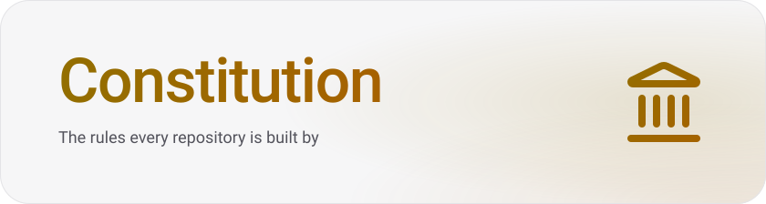

<p align="center">
  <picture>
    <source media="(prefers-color-scheme: dark)" srcset=".brand/banner-dark.svg">
    
  </picture>
</p>

<p align="center">
  &ensp;<a href="LICENSE.md"></a>
</p>

The Constitution is one set of engineering rules — how code is named, layered, tested, secured, reviewed and released — split into blocks. A project lists the blocks it follows in `constitution.yaml`, and each member of a workspace in one of its own. A Claude Code plugin gives an agent those rules when a session starts, names the ones that govern each file it touches, and holds the hand-back until the project's check passes. The configurations of the tools that hold the rules ship beside them.

- **One standard for every repository.** A rule is written once, in the block that gives it meaning, and every project that takes the block follows it.
- **Rules at the moment they matter.** The agent gets a digest when it starts, a reminder on each file it touches and a review when it asks for one.
- **Held by tools where a tool can hold them.** Biome, dependency-cruiser, knip, Ruff and the rest extend the presets, so a broken rule fails the check.
- **Pinned.** A project follows the release it names; a new release changes nothing until the project moves its pin.

##  Quick start

> Install the plugin, pin a release, ratify a project.

You need Claude Code and [mise](https://mise.jdx.dev).

1. Install the plugin, once per machine:

   ```bash
   claude plugin marketplace add droneey/constitution
   claude plugin install constitution@droneey
   ```

2. Pin a release in the project's `mise.toml`, add `/.droneey` to its `.gitignore` and run `mise install`. The release lands in `.droneey/constitution/`, and its `constitution` program for your platform on `PATH`, which the hooks run:

   ```toml
   [tools."github:droneey/constitution"]
   version = "<version>"
   asset_pattern = "constitution.tar.gz"
   strip_components = 0
   bin_path = "bin"

   [tools."github:droneey/constitution".platforms]
   linux-x64 = { additional_asset_patterns = ["constitution-linux-x64.tar.gz"] }
   linux-arm64 = { additional_asset_patterns = ["constitution-linux-arm64.tar.gz"] }
   macos-x64 = { additional_asset_patterns = ["constitution-macos-x64.tar.gz"] }
   macos-arm64 = { additional_asset_patterns = ["constitution-macos-arm64.tar.gz"] }

   [hooks]
   postinstall = [
     "mkdir -p .droneey",
     "ln -sfn \"$(mise where github:droneey/constitution)\" .droneey/constitution",
   ]
   ```

   `constitution doctor` then says whether the plugin, the program on `PATH`, the link and the git hooks are in place, and what to do about each that is not.

3. In a Claude Code session in the project, run [`/constitution:ratify`](docs/reference/skills.md#constitutionratify). It proposes the blocks from what the repository holds, finds its check command, asks you about the product, and writes `constitution.yaml`, `PROJECT.md` and `DECISIONS.md` once you agree.

4. Start a new session. The agent now works by the rules, and `/constitution:check` reviews a change against them.

##  Documentation

### Start

- [How it works](docs/how-it-works.md) — blocks, the plugin and the check

### Guides

- [Choose the blocks](docs/guides/choose-blocks.md) — what a project follows, and for which of its parts
- [Wire the tools](docs/guides/wire-the-tools.md) — extend the tools' configurations from the release
- [Override a rule](docs/guides/override-a-rule.md) — lower one rule, with a reason
- [Write a pack](docs/guides/write-a-pack.md) — blocks of your own, beside the Constitution's
- [Upgrade](docs/guides/upgrade.md) — move to a new release
- [Run the check in CI](docs/guides/check-in-ci.md) — the same gate on every pull request and commit

### Reference

- [`constitution.yaml`](docs/reference/constitution-yaml.md) — every key
- [Presets](docs/reference/presets.md) — what each tool's presets configure
- [Templates](docs/reference/templates.md) — the files a release starts a project from
- [Skills](docs/reference/skills.md) — what `/constitution:ratify`, `amend` and `check` do and write
- [The plugin](docs/reference/plugin.md) — skills, the reviewer and the hooks
- [Block format](docs/reference/block-format.md) — how a block and its rules are written
- [Terms](docs/reference/terms.md) — every term the blocks define, its owner, its axis and its definition
- [Glossary](PROJECT.md#glossary) — the words the Constitution uses in one meaning each

### Explanation

- [Where a rule goes](packages/constitution/blocks/core/foundation/placement.md) — its layer, its axis and its chapter
- [Which rule wins](packages/constitution/blocks/core/core.md#precedence) — overrides and the order of the layers
- [Decisions](DECISIONS.md) — every choice between real alternatives, with what was rejected

### Blocks

- [Core](packages/constitution/blocks/core/core.md) — what holds for any program
- [Domains](packages/constitution/blocks/domains) — the aspects a product may have, whatever its technology
- [Contexts](packages/constitution/blocks/contexts) — the platforms a program runs on and the languages it is written in
- [Implementations](packages/constitution/blocks/implementations) — the libraries, tools and services a project uses

##  Contributing

How the Constitution itself is changed, checked and released is in [CONTRIBUTING.md](CONTRIBUTING.md).

##  License

[PolyForm Internal Use 1.0.0](LICENSE.md): use it inside your own organisation, commercially or not; do not distribute, sublicense or sell it; keep the author's notice. Copyright Dmytro Kurovskyi.
