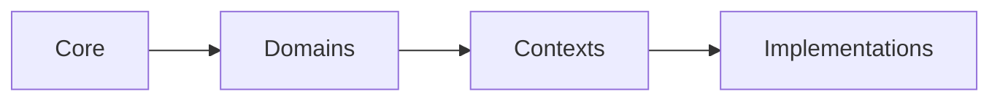
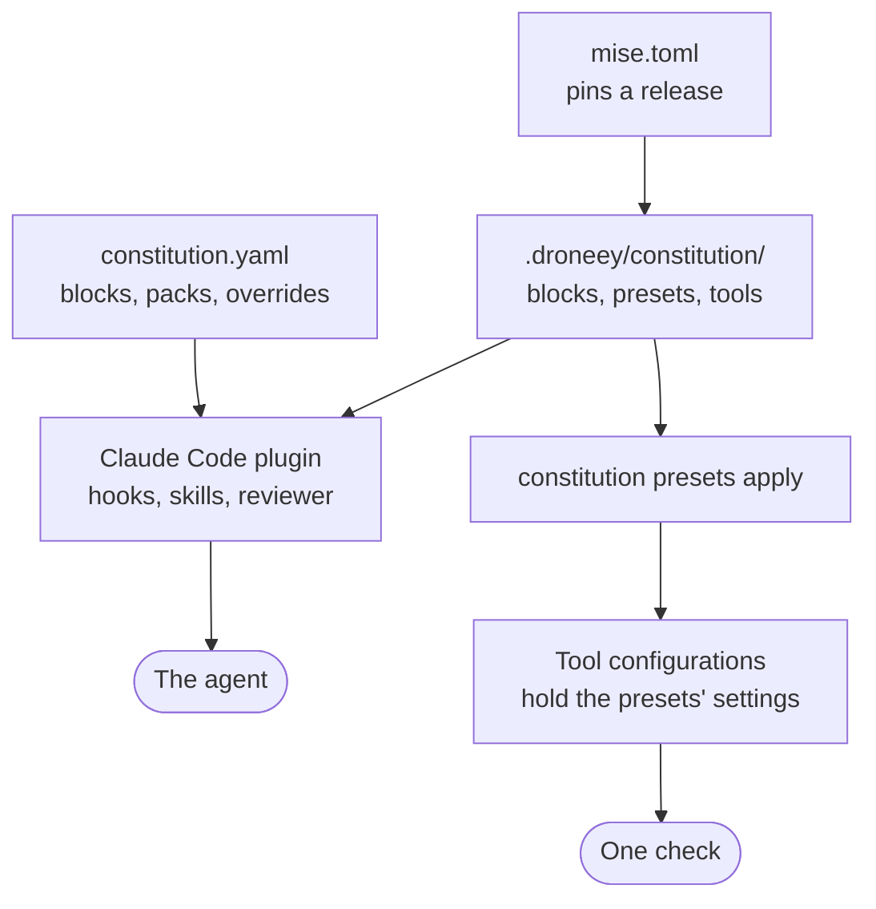

# How it works

> Blocks hold the rules, a project picks its blocks, the plugin brings them to the agent, and the check holds them.

## Blocks in ranks

A rule lives in the block without which it would mean nothing. The blocks sit in four ranks, from the widest to the narrowest:



| Rank | A block for | For example |
|---|---|---|
| Core | what holds for any program, always active | its chapters: `names`, `errors`, `tests` |
| Domains | an aspect a product may have | `presentation`, `integrations/remote-data`, `version-control` |
| Contexts | where the code runs, and what it is written in | `client/browser`, `client/cli`; `typescript`, `python` |
| Implementations | a library, a tool or a service | `react/react-dom`, `js-runtime/bun`, `biome` |

A block may hold child blocks, each a narrower case of it, in its own folder: `react/react-dom` sits under `react`, and `client/browser` under `client`. A block's id is its path, and a child turns on every block it sits under.

A block of a narrower rank tightens the ranks above it and never loosens them. Two active rules never contradict; a clash is a defect, and until it is fixed the rule naming the narrower case holds. [Which rule wins](../packages/constitution/blocks/core/core.md#precedence) has the whole order.

## Three axes

Inside a block, a rule sits in a chapter of one of three axes, each a folder of one form, `@foundation/`, `@architecture/` and `@workflow/`: its chapters, named for what their rules govern, and its seams with other blocks under `with/`. The block's passport beside them says what the block is and how it is set up. A project always follows `@foundation/`, and chooses the other two.

| Axis | Holds | A team leaves it out when |
|---|---|---|
| `foundation` | what any team wants | never |
| `architecture` | layers, ports and adapters, the homes of input, output and state, the tree | it has another architecture |
| `workflow` | branches, commits, review, hooks, release | it has another workflow |

## A rule

A rule is a heading with its slug and level, a statement that opens with its slogan, its reason under `#### Why`, and its examples under `#### Examples`:

````md
### failure-told-apart-by-code · MUST

Every failure is told apart by its type or its code, never by its message.

#### Why

A message is text anyone may reword at any time, so code that branches on it breaks silently at the next rewording.

#### Examples

```pseudo title="Avoid"
if error.message.includes("not found") then
  return showEmptyCart()
```

```pseudo title="Prefer"
if error.code is CartNotFoundError.code then
  return showEmptyCart()
```
````

`MUST` binds, and `SHOULD` is left only with a stated reason; [how to use it](../packages/constitution/blocks/core/core.md#how-to-use-it) says what each asks of the agent. A project may lower a rule in `constitution.yaml`, a `MUST` to `SHOULD` or either to `MAY`, which then only advises; `MAY` is a level only an override names. [The block format](reference/block-format.md#a-rule) gives every part of a rule and how a rule tightens another.

## What a project holds



- **`constitution.yaml`** names the blocks, the packs and the overrides; a member of a workspace keeps one of its own. [Every key](reference/constitution-yaml.md).
- **The release**, which mise installs and links as `.droneey/constitution/`, holds the blocks, the [presets](reference/presets.md) its executable writes into the tools' configurations, the shell scripts and the tools those configurations run, and the [templates](reference/templates.md); mise also puts its [`constitution` executable](reference/plugin.md#the-executable) on `PATH`, which checks the project and does the hooks' work.
- **The plugin** is the engine: the hooks, the skills and the reviewer. Its hooks run the release's executable, which reads the rules from the release, so every repository follows exactly the release it pins.
- **`PROJECT.md`** describes the product, and **`DECISIONS.md`** keeps the project's choices between real alternatives.

## A session

1. **At the start**, a hook gives the agent [the digest](reference/plugin.md#the-digest): the release, core's passport, what the rule gate asks, the map of the active blocks and the warnings about `constitution.yaml`.
2. **Before an edit or a command**, [the rule gate](reference/plugin.md#the-rule-gate) refuses it until the agent has read, whole, the rules that govern it and those of the files it read or changed. It writes them to files the agent reads: each governing chapter's vocabulary, then each rule's statement at the level that binds there, `MUST` before `SHOULD`, without its Why or its examples. What the agent has read is remembered, so only a new or a changed rule is asked for again. The tree a command or an MCP call is bracketed by is that of the call's working folder.
3. **After each tool call**, a hook records the files the agent read or changed, and names the blocks that govern a file it reads or edits, with their `MUST` rules, once per block. It runs no check.
4. **At the hand-back**, the stop hook holds the agent until the project's check, `constitution run check`, has passed on the tree with its changes, and then, where blocks govern the files it changed, until one `constitution:reviewer`, started fresh with none of the session's context, has reviewed them. The reviewer is given the diff, the overrides and the rules that govern the files with their Why, as `constitution rules --for <files> --why` prints them; [`/constitution:check`](reference/skills.md#constitutioncheck) runs both steps and routes the findings. A sub-agent's stop waits for the check alone, and its files become a review the session's agent owes.
5. **At the end**, a hook removes the session's folders from the projects; [the rest of what the hooks keep](reference/plugin.md#what-the-hooks-keep) stays for a resume.

A failed `constitution run check` names each rule its output shows broken, as `slug · LEVEL — statement`; `--why` adds each one's Why. [The plugin](reference/plugin.md#hooks) describes each hook, and [Skills](reference/skills.md) each skill.
