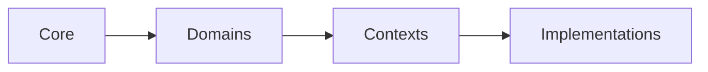
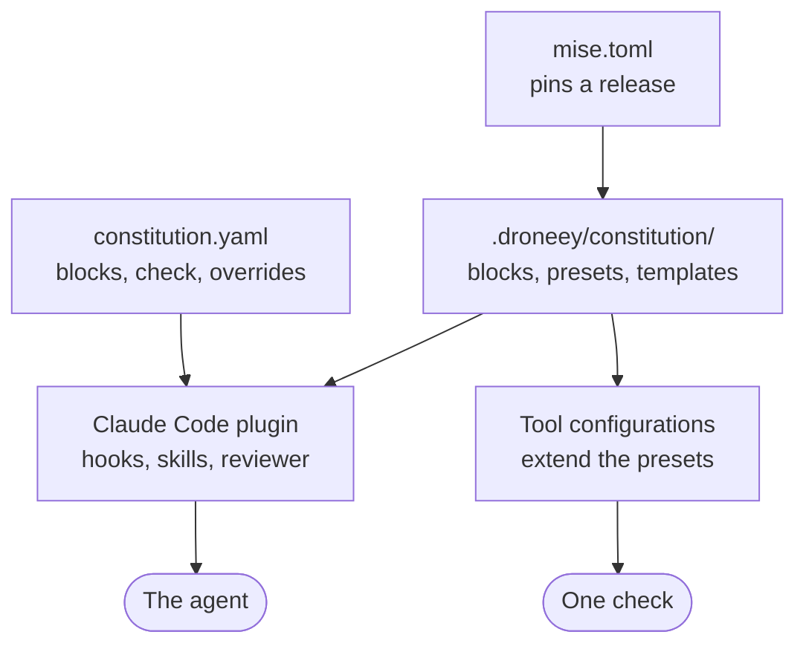

# How it works

> Blocks hold the rules, a project picks its blocks, the plugin brings them to the agent, and the check holds them.

## Blocks in layers

A rule lives in the block without which it would mean nothing. The blocks sit in four layers, from the widest to the narrowest:



| Layer | A block for | For example |
|---|---|---|
| Core | what holds for any program, always active | its chapters: `names`, `errors`, `tests` |
| Domains | an aspect a product may have | `ui`, `remote-data`, `version-control` |
| Contexts | where the code runs, and what it is written in | `browser`, `cli`; `typescript`, `python` |
| Implementations | a library, a tool or a service | `react-dom`, `bun`, `biome` |

A block of a narrower layer tightens the layers above it and never loosens them. Where two rules disagree, the narrower layer wins; [which rule wins](../packages/constitution/blocks/core/core.md#precedence) has the whole order.

## Three axes

Inside a block, a rule sits on one of three axes. A project always follows the base, and chooses the other two.

| Axis | Holds | A team leaves it out when |
|---|---|---|
| Base | what any team wants | never |
| `architecture` | layers, ports and adapters, the homes of input, output and state, the tree | it has another architecture |
| `workflow` | branches, commits, review, hooks, release | it has another workflow |

## A rule

A rule is a heading with its slug and level, a statement, and a table of its reason and tags:

```md
### failure-told-apart-by-code · MUST

A failure is told apart by its type or its code, never by its message.

| Why | Tags |
|---|---|
| a message is text a person may reword at any time. | [errors] |
```

| Level | Means |
|---|---|
| `MUST` | binds; a request against it gets the conflict and an alternative |
| `SHOULD` | is followed unless a reason is stated |
| `MAY` | is a choice |

A rule that tightens another names it after an arrow, `### class-declared-is-used → dead-code-deleted · MUST`, and is never looser than it. The tags are lenses, `a11y`, `data`, `errors`, `performance`, `security`, `testing` and `ux`, for a review of one concern across every block.

## What a project holds



- **`constitution.yaml`** names the release, the blocks, the check command and the overrides. [Every key](reference/constitution-yaml.md).
- **The release**, which mise installs and links as `.droneey/constitution/`, holds the blocks, the [presets](reference/presets.md), the [templates](reference/templates.md) and the tools the presets run.
- **The plugin** is the engine: the hooks, the skills and the reviewer. It reads the rules from the project's release, so every repository follows exactly the release it pins.
- **`PROJECT.md`** describes the product, and **`DECISIONS.md`** keeps the project's choices between real alternatives.

## A session

1. **At the start**, a hook gives the agent a digest: the release, the warnings about `constitution.yaml`, core, and every active block with its chapters.
2. **On each file** the agent reads or edits, a hook names the blocks that govern it and their MUST rules, once per block.
3. **At the hand-back**, a hook blocks the stop when the tree changed since the check last passed, and tells the agent to run it.
4. **On demand**, `/constitution:check` runs the check and asks the reviewer to judge the changed files against their rules.

[The plugin](reference/plugin.md) describes each hook and skill.
