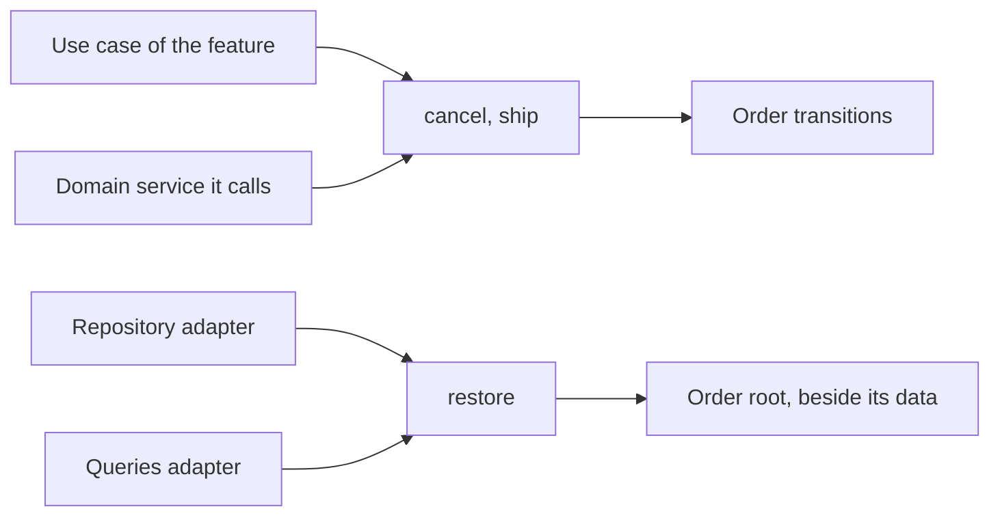

# Domain

> Governs the domain model: its language and the features it is cut into, its aggregates and their transitions, its value objects, domain services and events, and where a rule of the business lives.

## Vocabulary

The domain model speaks the **ubiquitous language**{#ubiquitous-language}: the business's own words, taken from the people who own it and kept in the project's glossary.

Each feature is a **bounded context**, as domain-driven design names it: one domain model in which a word has one meaning, though another feature may give it another — never a slice of one operation, nor a layer of the interface.

What two or more features use with one meaning is their **shared kernel**, the part of the domain model they use alike.

A **subdomain** is a part of what the business does, classed by what it is to the business: the **core domain** is what sets the product apart, a **supporting subdomain** serves it, and a **generic subdomain** solves what many products solve alike; each feature serves one subdomain or several.

The domain model is made of entities, as foundation's types chapter defines them, and of **value objects**, small immutable values with no identity of their own, compared by their data, most of which guard an invariant.

An **aggregate**{#aggregate} is entities and value objects changed as one, one boundary of consistency.

The **aggregate root**{#aggregate-root} is the entity through which alone an aggregate changes.

An aggregate's state is the whole value it holds at one moment, and its stage the part of that state from which the business allows its aggregate moves, as foundation's types chapter defines a value's state and stage.

An **aggregate transition** is a function that returns a state of an aggregate as a new value, with the domain event it decided where the business announces the move: its starting transition, as foundation's `names` defines it, and each **aggregate move**, a move the business allows from the stage the aggregate is in, each named by the business's verb.

An aggregate transition's **precondition** is what the business requires before it: for an aggregate move, that the business allows it from the stage the aggregate stands in; for the starting transition, what the business requires of a creation. An aggregate's rebuild from storage, as foundation's `names` defines it, restores it from what the store keeps of it — its last state, or the events that led to it — and is no aggregate transition.

The **aggregate version** of an aggregate counts the aggregate transitions that changed it: its starting transition sets it to 1, and each aggregate move that changes its state raises it by one, inside the transition. The aggregate's rebuild from storage restores the aggregate version stored, and the aggregate also keeps the aggregate version it was loaded at, which no aggregate move changes: the one its rebuild restored, or 0 where its starting transition built it.

A **domain service** is a rule or a computation of the domain model that no one aggregate, entity or value object owns: a pure function of the aggregates and values it decides on.

A **domain event** is what happened, in the past tense and the domain model's words, yielded by the transition that decided it, and a reaction to it is a use case, as the composition chapter defines one. The predicates and derived values of an aggregate, an entity or a value object answer about its state and change nothing; each language's block gives the form of all of these.

## Where rules live

### business-rule-lives-in-the-domain · MUST

Every rule of the business lives in the domain model. Such a rule would hold with no interface, no transport and no store, and stays there even with a single consumer.

#### Why

A rule of the business kept at a caller is skipped by the next caller, so the business holds through one door and not another.

#### Examples

```pseudo title="Avoid"
# orders/presentation/bindings/commands/place-order
function onPlace(request, placeOrder, context)
  if request.body.total < minimumTotal then
    return badRequest(BelowMinimumError)

  call placeOrder(parsePlaceOrderInput(request.body), context)
```

```pseudo title="Prefer"
# orders/domain/order/transitions/order.transitions
function place(orderId, cart)
  if cart.total < minimumTotal then
    throw new BelowMinimumError(cart.total)

  return { id: orderId, status: Placed, lines: cart.lines }

# orders/application/use-cases/commands/place-order.use-case
function createPlaceOrder({ cartRepository, orderRepository })
  return function(input, context)
    let cart = cartRepository.find(input.cartId, context)

    call orderRepository.save(place(input.orderId, cart), context)
```

### interface-rule-lives-with-its-interface · SHOULD

Every rule of an interface or a transport lives in the presentation or the adapter that owns it. It never lives in the domain model.

#### Why

A rule of a transport in the domain model ties the business to a caller it should not know, and changes it whenever that caller's wishes do.

#### Examples

```pseudo title="Avoid"
# orders/domain/order/entities/order.aggregate
function summaryLine(order)
  return truncate(order.note, SMS_MAX_CHARACTERS)
```

```pseudo title="Prefer"
# orders/infrastructure/sms/shipping-notifier.adapter
function toSmsText(order)
  return truncate(order.note, SMS_MAX_CHARACTERS)
```

### rule-of-one-thing-lives-beside-its-data · SHOULD

Every rule of one thing is a side-effect-free function of that thing alone, written once beside its data. It is a predicate or a derived value of one aggregate, entity or value object, or an operation of one value object, such as the sum of two amounts or whether two date ranges overlap.

#### Why

A rule about one thing written once beside it is changed and proven once, while a copy kept at a caller is copied with its mistakes and skipped by the next caller — information expert.

#### Examples

```pseudo title="Avoid"
# orders/domain/order/value-objects/order-status.value-object
type OrderStatus = Pending | Paid | Refunded

# presentation/widgets/order-details-widget
let canRefund = order.status is Paid
```

```pseudo title="Prefer"
# orders/domain/order/value-objects/order-status.value-object
type OrderStatus = Pending | Paid | Refunded

function isRefundable(status)
  return status is Paid

# presentation/widgets/order-details-widget
let canRefund = isRefundable(order.status)
```

### business-value-lives-in-the-domain · MUST

Every business value with an invariant is a value object of the domain model. It is never a mechanism of the presentation or of an adapter. An email address, an amount in its currency and a percentage are such values.

#### Why

An invariant checked by a mechanism of one door is skipped by every other door into the program, and a value that breaks it reaches the business rules.

#### Examples

```pseudo title="Avoid"
# users/presentation/bindings/commands/sign-up
function onSignUp(request, signUp, context)
  let text = request.body.email

  if not text.contains("@") then
    return badRequest(InvalidEmailError)

  call signUp({ email: text }, context)
```

```pseudo title="Prefer"
# users/domain/user/value-objects/email.value-object
type Email = { address: String }

function create(text)
  if not text.contains("@") then
    throw new InvalidEmailError()

  return { address: text }

# users/application/use-cases/commands/sign-up.use-case
function parseSignUpInput(body)
  return { email: Email.create(body.email) }

# users/presentation/bindings/commands/sign-up
function onSignUp(request, signUp, context)
  let input = parseSignUpInput(request.body)

  call signUp(input, context)
```

### value-object-checks-what-the-domain-relies-on · MUST

Every value object checks the invariants the domain model's rules rely on, and no more: an invariant without which a rule of the domain model would compute a wrong answer. A stricter check an interface asks for — a required field, a format hint, a stricter pattern — is the interface's own.

#### Why

A value object that checks what one interface wants refuses, through every other door, a value the domain model would accept, and changes whenever that interface's wishes do.

#### Examples

```pseudo title="Avoid"
# users/domain/user/value-objects/email.value-object
function create(text)
  if not text.contains("@") then
    throw new InvalidEmailError()

  if text.length > signUpFieldWidth then
    throw new EmailTooLongError()

  return { address: text }
```

```pseudo title="Prefer"
# users/domain/user/value-objects/email.value-object
function create(text)
  if not text.contains("@") then
    throw new InvalidEmailError()

  return { address: text }

# users/presentation/components/sign-up-form/sign-up-form.schema
let signUpFormSchema = schema({
  email: text().maxLength(signUpFieldWidth).check(Email.create)
})
```

### interface-check-composes-the-value-objects-check · SHOULD

Every stricter check an interface asks for of a value composes the value object's check and never restates it.

#### Why

A check restated at an interface drifts from the value object's, so the interface accepts a value the domain model refuses or refuses one it accepts.

#### Examples

```pseudo title="Avoid"
# users/presentation/components/sign-up-form/sign-up-form.schema
let signUpFormSchema = schema({
  email: text().maxLength(SIGN_UP_FIELD_WIDTH).pattern(/^[^@]+@[^@]+$/),
})
```

```pseudo title="Prefer"
# users/presentation/components/sign-up-form/sign-up-form.schema
let signUpFormSchema = schema({
  email: text().maxLength(SIGN_UP_FIELD_WIDTH).check(Email.create),
})
```

## Aggregates

### aggregate-changed-only-by-its-transitions · MUST

Every state an aggregate takes is one its aggregate transitions or its rebuild from storage built and checked: it is built only through its starting transition or its rebuild, and changed only through its aggregate moves, each returning, as a new value, a state that keeps every invariant. No other code builds the aggregate, a changed copy of it or one of its inner entities, or changes one in place.

#### Why

A value checked only when first built is valid only until the first change made elsewhere — the aggregate pattern.

#### Examples

```pseudo title="Avoid"
# orders/application/use-cases/commands/cancel-order.use-case
function createCancelOrder({ orderRepository })
  return function(input, context)
    let order = orderRepository.find(input.orderId, context)

    if order is <absent> then
      throw new OrderNotFoundError(input.orderId)

    call orderRepository.save({ ...order, status: Cancelled }, context)
```

```pseudo title="Prefer"
# orders/domain/order/transitions/order.transitions
function cancel(order)
  if order.status is Shipped then
    throw new OrderAlreadyShippedError(order.id)

  return { ...order, status: Cancelled }

# orders/domain/order/entities/order.aggregate
function restore(stored)
  if stored.lines is empty then
    throw new CorruptOrderError(stored.id)

  return stored

# orders/application/use-cases/commands/cancel-order.use-case
function createCancelOrder({ orderRepository })
  return function(input, context)
    let order = orderRepository.find(input.orderId, context)

    if order is <absent> then
      throw new OrderNotFoundError(input.orderId)

    call orderRepository.save(cancel(order), context)
```

### transition-checks-its-precondition · MUST

Every aggregate transition checks its precondition before it returns a state: the starting transition the creation's, each aggregate move the stage it starts from.

#### Why

A precondition a caller checks is skipped by the next caller, so a move the business forbids from the stage the aggregate stands in goes through — the aggregate pattern.

#### Examples

```pseudo title="Avoid"
# orders/domain/order/transitions/order.transitions
function ship(order, now)
  return {
    order: { ...order, status: Shipped },
    event: OrderShipped({ orderId: order.id, shippedAt: now }),
  }
```

```pseudo title="Prefer"
# orders/domain/order/transitions/order.transitions
function ship(order, now)
  if order.status is not Paid then
    throw new OrderNotPaidError({ orderId: order.id })

  return {
    order: { ...order, status: Shipped },
    event: OrderShipped({ orderId: order.id, shippedAt: now }),
  }
```

### repeated-move-changes-nothing · MUST

Every aggregate move repeated after it took effect returns the same state and no event. A repeat is a repeated transition, as foundation's effects chapter defines one: confirming an order again, or a deposit made again under its intent's identifier, while a deposit under a new identifier is a new move. It is the form `repeated-transition-does-nothing` takes in the domain model. Exempt: a repeat a rule of the business refuses, which fails with an expected failure.

#### Why

A move repeated by a retry that changes the state again or yields a second event turns every retry of a command into a second change, and a deposit taken for a repeat by its amount alone drops a second real one — Helland's idempotence, the idempotency key and Richardson's idempotent consumer.

#### Examples

```pseudo title="Avoid"
# orders/domain/order/transitions/order.transitions
function confirm(order, now)
  if order.status is not Placed and order.status is not Confirmed then
    throw new OrderNotPlacedError({ orderId: order.id })

  return {
    order: { ...order, status: Confirmed, version: order.version + 1 },
    event: OrderConfirmed({ orderId: order.id, confirmedAt: now }),
  }
```

```pseudo title="Prefer"
# orders/domain/order/transitions/order.transitions
function confirm(order, now)
  if order.status is Confirmed then
    return { order, event: <absent> }

  if order.status is not Placed then
    throw new OrderNotPlacedError({ orderId: order.id })

  return {
    order: { ...order, status: Confirmed, version: order.version + 1 },
    event: OrderConfirmed({ orderId: order.id, confirmedAt: now }),
  }
```

### adding-move-carries-the-identifier-of-its-intent · MUST

Every aggregate move that is an adding transition carries the identifier of its intent in its input. A deposit and a seat added to a booking are such moves.

#### Why

An adding move told from the next by its amount alone cannot be told from its own retry, so the aggregate either takes a retried deposit twice or drops a second real one — the idempotency key.

#### Examples

```pseudo title="Avoid"
# wallets/domain/wallet/transitions/wallet.transitions
function deposit(wallet, amount: Money)
  return { ...wallet, balance: Money.add(wallet.balance, amount) }
```

```pseudo title="Prefer"
# wallets/domain/wallet/transitions/wallet.transitions
function deposit(wallet, { depositId, amount })
  if depositId in wallet.depositIds then
    return wallet

  return {
    ...wallet,
    balance: Money.add(wallet.balance, amount),
    depositIds: wallet.depositIds + [depositId],
  }
```

### aggregate-bounded-by-its-true-invariants · MUST

Every aggregate holds its root and only what a true invariant binds to it at every change. An entity with a life of its own — created, changed or removed apart from its parent — is an aggregate of its own, and data kept together only to navigate, show or load it at once is what a query returns.

#### Why

An aggregate that holds what changes apart locks it on every change, and two people editing unrelated things collide, while one split where an invariant spans it lets its parts reach a state the two together forbid — model true invariants in consistency boundaries, and design small aggregates.

#### Examples

```pseudo title="Avoid"
# catalog/domain/product/entities/product.aggregate
type Product = {
  id: ProductId,
  price: Money,
  reviews: Review[]
}
```

```pseudo title="Prefer"
# catalog/domain/product/entities/product.aggregate
type Product = {
  id: ProductId,
  price: Money
}

# catalog/domain/review/entities/review.aggregate
type Review = {
  id: ReviewId,
  productId: ProductId,
  rating: Rating
}
```

### rule-independent-of-aggregates-saved-together · MUST

Every rule holds whether or not several aggregates are saved together. No rule relies on it: an invariant across them at once makes them one aggregate, one that may lag is kept by a reaction to the event of the change, and being created together binds nothing.

#### Why

An invariant left to a transaction that happens to save both aggregates breaks the first time one of them is saved alone — model true invariants in consistency boundaries.

#### Examples

```pseudo title="Avoid"
# library/application/use-cases/commands/lend-book.use-case
let loan = Loan.open(input.loanId, input.bookId, input.memberId)
let member = Member.addLoan(foundMember, input.loanId)

# Why: saved in one transaction, so a member never exceeds the loan limit
call store.saveTogether([loan, member], context)
```

```pseudo title="Prefer"
# library/domain/member/transitions/member.transitions
function borrow(member, loanId)
  if member.loanIds.size >= LOAN_LIMIT then
    throw new LoanLimitReachedError({ memberId: member.id })

  return { ...member, loanIds: member.loanIds + [loanId] }

# library/application/use-cases/commands/lend-book.use-case
call memberRepository.save(Member.borrow(foundMember, input.loanId), context)
```

### aggregate-references-another-by-identifier · MUST

Every aggregate holds another only by its identifier, never as a copy of its state or a reference to it. A rule that needs both is decided by a transition handed the values it needs of the other, or by a domain service, as `domain-service-holds-a-rule-of-several` gives.

#### Why

A copy of another aggregate goes stale at the other's next change and tempts a change of both at once where no invariant asks it, while an identifier keeps each its own boundary of consistency — reference other aggregates by identity.

#### Examples

```pseudo title="Avoid"
# sales/domain/order/entities/order.aggregate
type Order = {
  id: OrderId,
  customer: Customer,
  lines: OrderLine[]
}
```

```pseudo title="Prefer"
# sales/domain/order/entities/order.aggregate
type Order = {
  id: OrderId,
  customerId: CustomerId,
  lines: OrderLine[]
}

# sales/domain/order/transitions/order.transitions
function place(orderId, lines, { customerId, isCustomerBlocked })
  if isCustomerBlocked then
    throw new CustomerBlockedError(customerId)

  return { id: orderId, customerId, lines }
```

### domain-model-changed-only-through-a-use-case · MUST

The domain model changes only through a use case. Only use cases, and the domain services they call, call an aggregate's transitions, and one use case may change several aggregates of its feature. Exempt: a spec and its fixtures, which call what they prove or build.

#### Why

A change made outside a use case is neither checked against the store, saved nor announced, and the caller that made it holds a state no one else sees.

#### Examples



## Events

### transition-yields-its-event · MUST

Every transition whose move the business announces returns the domain event it decided beside the state it reaches. No other code, a use case among them, makes a domain event.

#### Why

An event made apart from the transition that decided it can announce what the transition never decided, or miss what it did — the domain event pattern.

#### Examples

```pseudo title="Avoid"
# orders/application/use-cases/commands/ship-order.use-case
function createShipOrder({ orderRepository, clock })
  return function(input, context)
    let order = orderRepository.find(input.orderId, context)

    if order is <absent> then
      throw new OrderNotFoundError(input.orderId)

    let event = { orderId: order.id, shippedAt: clock.now() }

    call orderRepository.save(ship(order), [event], context)
```

```pseudo title="Prefer"
# orders/domain/order/events/order-shipped.event
type OrderShipped = { orderId: OrderId, shippedAt: Instant }

# orders/domain/order/transitions/order.transitions
function ship(order, now)
  if order.status is not Paid then
    throw new OrderNotPaidError(order.id)

  return {
    order: { ...order, status: Shipped },
    event: { orderId: order.id, shippedAt: now }
  }

# orders/application/use-cases/commands/ship-order.use-case
function createShipOrder({ orderRepository, clock })
  return function(input, context)
    let order = orderRepository.find(input.orderId, context)

    if order is <absent> then
      throw new OrderNotFoundError(input.orderId)

    let shipped = ship(order, clock.now())

    call orderRepository.save(shipped.order, [shipped.event], context)
```

### domain-event-carries-the-facts-of-its-move · MUST

Every domain event carries what its readers need of the move it announces. That is its aggregate's identifier and the aggregate version its transition reached, the instant it happened and the values the move decided, so no reader loads the aggregate again to learn what happened.

#### Why

An event that names only its aggregate sends each reader to load a state that may have changed since, so a reaction acts on what the event never announced — the domain event pattern.

#### Examples

```pseudo title="Avoid"
# orders/domain/order/events/order-shipped.event
type OrderShipped = { orderId: OrderId }
```

```pseudo title="Prefer"
# orders/domain/order/events/order-shipped.event
type OrderShipped = {
  orderId: OrderId,
  version: AggregateVersion,
  shippedAt: Instant,
  carrier: Carrier,
  trackingNumber: TrackingNumber,
}
```

## Domain services

### domain-service-holds-a-rule-of-several · SHOULD

Every rule no one aggregate, entity or value object owns is a domain service, which the domain layer declares. Its main case is a decision or a computation over several aggregates.

#### Why

A rule of several aggregates written in a use case is copied by every use case that needs it, and one written into one of the aggregates makes it know the others — the domain service pattern.

#### Examples

```pseudo title="Avoid"
# sales/domain/cart/entities/cart.aggregate
type Cart = { id: CartId, lines: CartLine[] }

function discountedTotal(cart, promotion)
  let total = cartTotal(cart)

  if total < promotion.minimumTotal then
    return total

  return total.minus(promotion.discount)
```

```pseudo title="Prefer"
# sales/domain/cart/entities/cart.aggregate
type Cart = { id: CartId, lines: CartLine[] }

# sales/domain/pricing/services/discounted-total.service
function discountedTotal(cart, promotion)
  let total = cartTotal(cart)

  if total < promotion.minimumTotal then
    return total

  return total.minus(promotion.discount)
```

### domain-service-takes-no-port · SHOULD

Every domain service decides only on the values it is handed, and takes no port.

#### Why

A service that asks a port mixes the decision with the effect, so its decision is proven only through a fake of the port, while one handed what it decides on is proven on plain values — the domain service pattern, in its stricter form that takes no port, and a functional core in an imperative shell.

#### Examples

```pseudo title="Avoid"
# orders/domain/allocation/services/order-allocation.service
function allocate(order, stockRepository, context)
  let stock = call stockRepository.findForSkus(Order.skus(order), context)
  return pickWarehouse(order, stock)
```

```pseudo title="Prefer"
# orders/domain/allocation/services/order-allocation.service
function allocate(order, stock)
  return pickWarehouse(order, stock)

# orders/application/use-cases/commands/allocate-order.use-case
let stock = call stockRepository.findForSkus(Order.skus(order), context)
let allocation = allocate(order, stock)
```

## Features

### feature-cut-where-the-language-changes · SHOULD

Every feature is cut where the ubiquitous language and its domain model change. Inside it each word has one meaning and it holds one domain model, never cut per interface, kind of stored record or entity; two features that share an aggregate or its rules to say what they do are one feature.

#### Why

A feature cut finer than its model duplicates the model and translates between its copies on every call, and one that spans two languages gives a word two meanings inside it — bounded context, in the stricter form that makes each feature one.

#### Examples

```text title="Avoid"
features/
├── order-api/      the HTTP routes
├── order-worker/   the queue jobs
├── order-items/    a stored record
└── order-totals/   one entity
```

```text title="Prefer"
features/
├── ordering/   Order: a cart bought
├── shipping/   Shipment: parcels sent
└── billing/    Invoice: money owed
```

### feature-classed-by-its-subdomain · SHOULD

Each feature is classed by the most valuable subdomain it serves: the core domain, a supporting subdomain or a generic subdomain. A composition module with a domain model of its own is classed the same way.

#### Why

Modelling effort spent evenly is spent mostly where the business gains least — the distillation of the core domain.

#### Examples

```md title="Avoid"
<!-- PROJECT.md -->
| Feature  | Subdomains                       | Class      |
|----------|----------------------------------|------------|
| bookings | seat reservations, dynamic fares | supporting |
```

```md title="Prefer"
<!-- PROJECT.md -->
| Feature  | Subdomains                       | Class |
|----------|----------------------------------|-------|
| bookings | seat reservations, dynamic fares | core  |
```

### subdomain-classes-recorded-in-project-md · SHOULD

`PROJECT.md` names the core domain, and each feature's subdomains and class. A composition module with a domain model of its own is named there the same way.

#### Why

A class kept in no file is decided again by each reader, so the effort it was to steer goes where each of them guesses — the distillation of the core domain.

#### Examples

```text title="Avoid"
PROJECT.md

## Features

- fares: prices each seat as demand changes
- bookings: holds and confirms seats
- notifications: emails and texts
```

```text title="Prefer"
PROJECT.md

## Subdomains

The core domain is dynamic fares.

| Feature       | Subdomain         | Class      |
|---------------|-------------------|------------|
| fares         | dynamic fares     | core       |
| bookings      | seat reservations | supporting |
| notifications | messaging         | generic    |
```

### generic-feature-models-only-what-it-cannot-take · SHOULD

Every feature classed generic models only what is its own, what no library or outside system it can take already does.

#### Why

A generic subdomain built where one could be taken spends the effort the core domain needed — the distillation of the core domain.

#### Examples

```text title="Avoid"
features/notifications/          generic
└── domain/
    ├── email-template/          a template engine of its own
    ├── delivery-retry/          retries and bounces of its own
    └── recipient-preference/
```

```text title="Prefer"
features/notifications/          generic
├── domain/
│   └── recipient-preference/
└── infrastructure/
    └── mail-provider/           templates, retries and bounces taken from the provider
```

### generic-feature-keeps-no-core-term · SHOULD

Every feature classed generic keeps no term of the core domain, so that what others built can replace it.

#### Why

A generic feature that carries the core domain's terms can no longer be replaced by what others built, and changes whenever the core domain does — the distillation of the core domain.

#### Examples

```pseudo title="Avoid"
# notifications/application/contracts/message-sender.port
type MessageSenderPort = {
  sendFareDrop: function(passenger: Passenger, fare: DynamicFare, context)
}
```

```pseudo title="Prefer"
# notifications/application/contracts/message-sender.port
type MessageSenderPort = {
  send: function(recipient: Recipient, message: Message, context)
}
```
