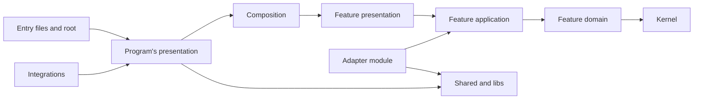

# Layers

> Governs the layers: the direction of their imports and the effects they may hold.

## Vocabulary

The import rules of this chapter together are the **layer matrix**{#layer-matrix}; they hold the order inward, the edge and the shared layers as the layout's vocabulary gives them, and the language's block names the source root, the surface and the suffix form.

A **format library** is a library of one outside format or arithmetic — a numbering plan, bank account numbers, decimal arithmetic, calendar dates and times, an identifier's format —, which does no input or output, holds no state or configuration, needs no framework and is pinned exactly; a general schema or parsing library is none.

## Direction

### import-points-inward · MUST

Every import points inward, toward stability, in the order the layout gives, and never the reverse way. An import made only for types counts like any other, here and under every other rule of the layer matrix.

#### Why

An outward import lets a volatile detail break a stable rule — the dependency rule.

#### Examples



### domain-imports-only-itself-and-the-kernel · MUST

Of the program's code, the domain layer imports only itself and the kernel. It imports nothing of the kernel's `contracts/`, and never a port, a use case or anything of the presentation.

#### Why

A domain layer that imports a port, a use case or the presentation changes whenever they do and can no longer be read or tested alone, though it is the most stable code of the program — the dependency rule.

#### Examples

```pseudo title="Avoid"
# orders/domain/order/transitions/order.transitions
import { Money } from "kernel"
import { OrderRepositoryPort } from "../../../application/contracts"

function cancel(order, orders: OrderRepositoryPort, context)
  ...
```

```pseudo title="Prefer"
# orders/domain/order/transitions/order.transitions
import { Money } from "kernel"
import { Order } from "../entities"

function cancel(order: Order)
  ...
```

### application-imports-only-its-domain-the-kernel-and-composed-surfaces · MUST

Of the program's code, the application layer imports only itself, its domain layer and the kernel. In composition it also imports the surfaces of the features it composes; it never imports an adapter, a presentation or the composition root.

#### Why

A use case that knows a framework, an adapter or a transport can run nowhere else, and the next interface, worker or subcommand must write it again — ports and adapters.

#### Examples

```pseudo title="Avoid"
# orders/application/use-cases/commands/place-order.use-case
import { createOrderRepository } from "orders/infrastructure/database"
import { orderIds } from "root"
```

```pseudo title="Prefer"
# orders/application/use-cases/commands/place-order.use-case
import { OrderRepositoryPort } from "orders/application/contracts"
import { create } from "orders/domain/order/transitions"
import { Money } from "kernel"
```

### adapter-imports-only-its-owners-domain-ports-or-shared-layers · MUST

Every adapter imports only its own adapter module, what its port owner's ports speak and the shared layers. What those ports speak is its port owner's domain layer and ports. It never imports a use case, a presentation, another composition module or another adapter module. An edge worker imports as its adapter module's adapters do, receiving from the root the ports it hands its work to. Exempt: an adapter that answers a feature's port through another feature, which reaches the asking feature and the answering one, the answering one's query among them, through their surfaces, and the event port's adapter, which imports the surfaces of the features whose events it maps.

#### Why

Adapters that know each other or their callers form a hidden second program beside the domain.

#### Examples

```pseudo title="Avoid"
# orders/infrastructure/database/order-repository.adapter
import { Order } from "../../domain/order/entities"
import { toCents } from "../payment-provider"
import { placeOrder } from "../../application/use-cases/commands"
```

```pseudo title="Prefer"
# orders/infrastructure/database/order-repository.adapter
import { Order } from "../../domain/order/entities"
import { OrderRepositoryPort } from "../../application/contracts"
import { toCents } from "libs/money"
```

### concept-imports-only-anothers-values · SHOULD

Every concept of a domain layer imports another concept of its feature only for its identifier and its value objects. It never imports the other's entities, transitions or services. Exempt: a domain service of several concepts, which takes their aggregates.

#### Why

A concept that reaches another's entities or transitions changes with them and can change them, and the boundary of each aggregate holds only on paper.

#### Examples

```pseudo title="Avoid"
# orders/domain/shipment/transitions/shipment.transitions
import { Order } from "../../order/entities"
import { cancel } from "../../order/transitions"
```

```pseudo title="Prefer"
# orders/domain/shipment/transitions/shipment.transitions
import { OrderId, Address } from "../../order/value-objects"
```

### domain-shared-imports-no-concept · SHOULD

Every domain layer's `shared/` is imported by its concepts and imports none of them.

#### Why

A `shared/` that knows a concept becomes part of it, and every other concept that uses it is tied to that concept unseen, or caught in a cycle with it.

#### Examples

```pseudo title="Avoid"
# orders/domain/shared/value-objects/delivery-window.value-object
import { OrderStatus } from "../../order/value-objects"
```

```pseudo title="Prefer"
# orders/domain/shared/value-objects/delivery-window.value-object
import { CalendarDate } from "kernel"

# orders/domain/order/value-objects/order-status.value-object
import { DeliveryWindow } from "../../shared/value-objects"
```

### feature-never-imports-a-feature · MUST

Every feature is combined with another only by a layer above them, composition or the program's presentation, and never imports it.

#### Why

A feature that knows another cannot change, be tested or be removed alone.

#### Examples

```pseudo title="Avoid"
# orders/application/use-cases/commands/place-order.use-case
import { getCustomer } from "features/customers"
```

```pseudo title="Prefer"
# orders/application/use-cases/commands/place-order.use-case
import { CustomerStandingPort } from "../../contracts"

# composition/ordering/infrastructure/customers/customer-standing.adapter
import { CustomerStandingPort } from "features/orders"
import { getCustomer, Customer } from "features/customers"
```

### composition-module-never-imports-another · MUST

Every composition module composes in itself what it needs of the features, never importing another; what two of them need is composed in each, or the two become one module.

#### Why

A composition module that leans on another becomes a layer above it, and composition stops being one flat level any composition module can be read from alone.

#### Examples

```pseudo title="Avoid"
# composition/refunds/application/use-cases/commands/refund-checkout.use-case
import { getCheckoutTotal } from "composition/checkout"
import { refundPayment } from "features/payments"
```

```pseudo title="Prefer"
# composition/refunds/application/use-cases/commands/refund-checkout.use-case
import { getOrder } from "features/orders"
import { refundPayment } from "features/payments"
```

### program-presentation-imports-only-surfaces-and-shared-layers · SHOULD

Of what lies inward of it, the program's presentation imports only the surfaces of features and composition modules and the shared layers.

#### Why

The program's presentation spans every feature, so one import past a surface ties all of it to a feature's internals.

#### Examples

```pseudo title="Avoid"
# presentation/screens/order-screen
import { OrderQueriesPort } from "features/orders/application/contracts"
import { isRefundable } from "features/orders/domain/order/value-objects"
```

```pseudo title="Prefer"
# presentation/screens/order-screen
import { getOrder, isRefundable } from "features/orders"
import { getInvoice } from "features/billing"
import { Money } from "kernel"
```

### root-imported-only-by-entry-files · MUST

The composition root is imported only by entry files. Exempt: specs.

#### Why

The root knows every concrete choice, and code that imports it can no longer be tested with fakes.

#### Examples

```pseudo title="Avoid"
# orders/application/use-cases/commands/place-order.use-case
import root from "root"

function createPlaceOrder({ cartRepository })
  return function(input, context)
    let orderRepository = root.orderRepository
    let cart = cartRepository.find(input.cartId, context)

    call orderRepository.save(place(input.orderId, cart), context)
```

```pseudo title="Prefer"
# orders/application/use-cases/commands/place-order.use-case
function createPlaceOrder({ cartRepository, orderRepository })
  return function(input, context)
    let cart = cartRepository.find(input.cartId, context)

    call orderRepository.save(place(input.orderId, cart), context)

# main
import run from "root"

run(process.env)
```

### adapter-imported-only-by-the-root · MUST

Every adapter is imported only by the composition root, through its adapter module's surface. A use case or a composition module receives it through its port, a binding or delivery unit receives the use case built over it, and an edge worker is imported and started by the root alone. Exempt: specs, and the surface through which a package offers it to consumers.

#### Why

An adapter imported past its port binds its caller to the vendor the port hides, and a spec can replace it only by patching the import.

#### Examples

```pseudo title="Avoid"
# orders/application/use-cases/commands/confirm-order.use-case
import SmtpMailerAdapter from "infrastructure/smtp"

function createConfirmOrder({ orderRepository })
  return function(input, context)
    let order = orderRepository.find(input.orderId, context)
    let mailer = new SmtpMailerAdapter(smtpClient)
    mailer.send(order.customerEmail, context)
```

```pseudo title="Prefer"
# orders/application/use-cases/commands/confirm-order.use-case
function createConfirmOrder({ orderRepository, mailer })
  return function(input, context)
    let order = orderRepository.find(input.orderId, context)
    mailer.send(order.customerEmail, context)

# root/orders
import SmtpMailerAdapter from "infrastructure/smtp"

let mailer = new SmtpMailerAdapter(smtpClient)
let confirmOrder = createConfirmOrder({ orderRepository, mailer })
```

### entrypoint-never-imported · MUST

No code imports an entrypoint.

#### Why

An entrypoint is a separate artefact, so importing it drags that artefact into another.

#### Examples

```pseudo title="Avoid"
# entrypoints/admin/main
import remindCarts
  from "entrypoints/worker"
```

```pseudo title="Prefer"
# entrypoints/admin/main
import runAdmin from "root"

runAdmin(process.args, process.env)

# entrypoints/worker/main
import runWorker from "root"

runWorker(process.env)

# root/carts
import createRemindCarts from "features/carts"
```

### integration-never-imported · MUST

No other code of the package imports an integration.

#### Why

An integration imported by the rest of the package loads the framework it plugs into for every consumer.

#### Examples

```pseudo title="Avoid"
# features/catalogue/presentation/product-card
import { cmsSettings } from "../../../integrations/cms/main"

function ProductCard({ product })
  return card(product, cmsSettings.theme)
```

```pseudo title="Prefer"
# features/catalogue/presentation/product-card
function ProductCard({ product, theme })
  return card(product, theme)
```

### integration-imports-only-surfaces · SHOULD

Every integration imports only the root's surface and the surfaces of the package's folder modules. It never imports the package's main published entry or another integration.

#### Why

An integration that imports another ties the frameworks they plug into to each other, and one that imports the package's main published entry loads what the package offers its consumers instead of the program it integrates.

#### Examples

```pseudo title="Avoid"
# integrations/cms-plugin/main
import { createProgram } from "../../<surface>"
import { registerSearch } from "../search-plugin/main"
```

```pseudo title="Prefer"
# integrations/cms-plugin/main
import { createProgram } from "../../root"
import { renderProductCard } from "../../features/catalogue"
```

### kernel-imports-only-itself · MUST

Of the program's code the kernel imports only itself. Beyond it, it imports only the data files its values are read from, the standard library and the installed dependencies its role admits.

#### Why

Everything depends on the kernel, so a change in anything it imports reaches every feature at once — the stable dependencies principle.

#### Examples

```pseudo title="Avoid"
# kernel/value-objects/money.value-object
import Currency from "features/billing"

type Money = {
  cents: Integer,
  currency: Currency,
}
```

```pseudo title="Prefer"
# kernel/value-objects/money.value-object
import Currency from "./currency.value-object"

type Money = {
  cents: Integer,
  currency: Currency,
}
```

### libs-import-no-code-of-the-program · MUST

Every lib stands apart from the program: it imports none of its code outside `libs/`.

#### Why

A lib could be published tomorrow, and one import of the program ties it to this program for good.

#### Examples

```pseudo title="Avoid"
# libs/retries/retry.utils
import PaymentDeclinedError from "kernel"

function retry(action, times)
  try
    return action()
  catch error
    let isPermanent = error is PaymentDeclinedError

    if times is 1 or isPermanent
      throw error

    return retry(action, times - 1)
```

```pseudo title="Prefer"
# libs/retries/retry.utils
function retry(action, { times, isPermanent, backoff })
  try
    return action()
  catch error
    if times is 1 or isPermanent(error)
      throw error

    wait(backoff.next())

    return retry(action, { times: times - 1, isPermanent, backoff })
```

### shared-imports-no-feature-adapter-port-or-root · MUST

The top-level `shared/` stays plumbing: it imports no feature, adapter or port, the kernel's included, and no composition root.

#### Why

Plumbing that knows a feature becomes part of it, and every other feature that uses it is tied to it unseen.

#### Examples

```pseudo title="Avoid"
# shared/pagination/page.types
import Order from "features/orders"

type OrderPage = {
  orders: Order[],
  next: Cursor,
}
```

```pseudo title="Prefer"
# shared/pagination/page.types
type Page<Row> = {
  rows: Row[],
  next: Cursor,
}
```

### layer-imports-dependencies-by-its-role · MUST

Each folder imports only the installed dependencies its role admits: the edge any, the application layer none, the domain layer and the kernel none but a format library, and every other folder only a dependency whose block gives it a home there. A dependency with no home is imported only at the edge. Exempt: test code, which imports what it needs.

#### Why

A dependency imported wherever it is handy spreads its volatility into layers that should not change with it, while one table by role holds every dependency, those nobody wrote a rule for included.

#### Examples

```text title="Tree"
src/
├── <entry>                 any dependency: the edge
├── root/                   any dependency: the edge
├── composition/            only one whose block gives it a home here
├── features/orders/
│   ├── presentation/       only one whose block gives it a home here
│   ├── application/        none
│   ├── domain/             none but a format library
│   └── infrastructure/     any dependency: the edge
├── kernel/                 none but a format library
├── shared/                 only one whose block gives it a home here
├── infrastructure/         any dependency: the edge
└── libs/                   any dependency: the edge
```

### format-library-kept-inside-its-value-objects · SHOULD

Every format library the domain layer or the kernel imports is imported only by the value objects that need it. Its types and its failures stay out of every signature. Exempt: specs, which import what they need.

#### Why

A format library that leaks past its value objects makes the domain model speak its types, so replacing it reaches every rule that took them.

#### Examples

```pseudo title="Avoid"
# orders/domain/order/transitions/order.transitions
import { Decimal } from "decimal-library"

function addLine(order, unitPrice: Decimal, quantity: Quantity)
  ...
```

```pseudo title="Prefer"
# kernel/value-objects/money.value-object
import { Decimal } from "decimal-library"

type Money = { minorUnits: Integer, currency: Currency }

function applyRate(money: Money, rate: Percentage): Money
  let amount = Decimal.of(money.minorUnits).times(rate.value).roundHalfEven()
  return { minorUnits: amount.toInteger(), currency: money.currency }

# orders/domain/order/transitions/order.transitions
function addLine(order, unitPrice: Money, quantity: Quantity)
  ...
```

## Effects

### effects-held-only-by-the-edge · MUST

Only the edge holds effects. Every other unit reaches one only through a port its adapters implement — the domain layer none —, calls nothing of a library or the standard library that holds one, and imports nothing the block of its language or its runtime bars. Exempt: a diagnostic written through the diagnostic handles, a binding unit's timer that schedules its own work, and a delivery unit reading and writing through the input and output its calling framework hands it, a request and its reply or the streams of a run.

#### Why

Logic that holds an effect answers differently from run to run, so its specs need the real effect or a patch of it, run slowly and fail at random — ports and adapters, and a functional core in an imperative shell.

#### Examples

```pseudo title="Avoid"
# coupons/application/use-cases/commands/issue-coupon.use-case
function createIssueCoupon({ couponRepository })
  return function(input, context)
    let code = randomCode()

    call couponRepository.save(issue(input.couponId, code), context)
```

```pseudo title="Prefer"
# coupons/application/use-cases/commands/issue-coupon.use-case
function createIssueCoupon({ couponRepository, codeSource })
  return function(input, context)
    let code = codeSource.next()

    call couponRepository.save(issue(input.couponId, code), context)
```

### contained-failure-reported-through-the-fault-reporter · MUST

Every failure of an optional part that a use case contains reaches the operator through the fault reporter the root hands in. Neither the use case's result nor its failure carries it.

#### Why

A contained failure that only a log would show is either lost or logged by a domain or application layer that should not decide what an operator is told.

#### Examples

```pseudo title="Avoid"
# shop/application/use-cases/queries/show-product.use-case
let recommendations = []

try
  recommendations = call recommender.similarTo(product.id, context)
catch error
  logger.warn("recommendations failed", error)
```

```pseudo title="Prefer"
# shop/application/use-cases/queries/show-product.use-case
function createShowProduct({ catalogue, recommender, faultReporter })
  return function(input, context)
    let product = call catalogue.find(input.productId, context)
    let recommendations = Unavailable

    try
      recommendations = call recommender.similarTo(product.id, context)
    catch error
      faultReporter.report(error)

    return { product, recommendations }
```
