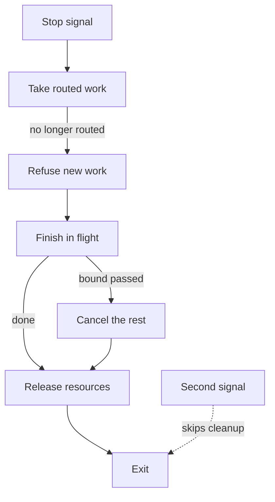

# Effects

> Governs what a program does beyond computing a value: its calls across a process boundary, their deadlines, cancellation and load, its resources, concurrent work, operations, writes, stop and debug output.

## Vocabulary

An **effect** is what a program does beyond computing a value: input and output, the network, storage, the file system, the clock, randomness, the minting of a new identifier, environment variables or a process.

A **live system** is a running system others use, or a store whose data outlives the task at hand, such as a shared service, a production database or a user's account; the repository's files that a change edits are none.

An **irreversible operation** is one run outside the product's own flow, such as by hand, by a script, by a data fix or by a migration, that destroys data, spends money, changes a system or sends something outward; an operation of the product its user invokes for that very effect is none.

A process's **environment variables** are the named values it receives from whoever starts it.

A program's **host** is what runs it where it is deployed and hands it its settings, its secrets and its signals, such as a machine, a container platform or a scheduler.

A **deployment environment** is one place the program is deployed to, with its own settings, data and users, such as production, a staging copy or a developer's machine, never one deploy of one release.

A **lock** keeps other work from what it guards while its holder holds it, whether the program holds it in its memory or a store holds it within one of its transactions.

A **stored change** is a change a write keeps in a store the program owns, and an **unstored change** one no such write keeps, such as a change held only in memory or kept by an outside system that owns it.

An **overwriting transition** gives what it changes a value that does not depend on the one it starts from, as moving an order into a stage or renaming an account does, and an **adding transition** adds to a value or takes from it, as a deposit or a withdrawal does. A **repeated transition** runs again after it took effect: an overwriting transition with the same input, an adding transition with the same identifier of its intent; an adding transition with a new identifier is a new one.

## Calls

### outside-call-has-a-timeout · MUST

Every call across a process boundary has a timeout.

#### Why

A call without a timeout can hang for ever and take its caller with it.

#### Examples

```pseudo title="Avoid"
function fetchExchangeRates()
  return http.get(ratesUrl)
```

```pseudo title="Prefer"
function fetchExchangeRates()
  return http.get(ratesUrl, {
    timeout: RATES_TIMEOUT,
  })
```

### call-takes-the-remaining-deadline · SHOULD

Wherever its work has a deadline, every call across a process boundary takes the time that work has left. Such work is a request or a job, and a timeout of the call's own, where it has one, is never longer than the time left.

#### Why

A nested call with a full timeout of its own keeps working after its caller has stopped waiting, and its answer reaches nobody — deadline propagation.

#### Examples

```pseudo title="Avoid"
# checkout/application/use-cases/commands/check-out.use-case
function createCheckOut({ pricing, payments })
  return function(input, context)
    let quote = pricing.quote(input.cartId, {
      timeout: QUOTE_TIMEOUT,
    })

    call payments.charge(quote, {
      timeout: CHARGE_TIMEOUT,
    })
```

```pseudo title="Prefer"
# checkout/application/use-cases/commands/check-out.use-case
function createCheckOut({ pricing, payments })
  return function(input, context)
    let quote = pricing.quote(input.cartId, {
      deadline: context.deadline,
    })

    call payments.charge(quote, {
      deadline: context.deadline,
    })
```

### call-never-made-once-its-deadline-passed · SHOULD

No call across a process boundary made for work with a deadline is made once that work has no time left.

#### Why

A call made once its work has no time left spends the other side's capacity on an answer nobody waits for — deadline propagation.

#### Examples

```pseudo title="Avoid"
# payments/infrastructure/card-gateway/payment.adapter
function charge(payment, context)
  call client.charge(toCharge(payment), {
    timeout: remaining(context.deadline),
  })
```

```pseudo title="Prefer"
# payments/infrastructure/card-gateway/payment.adapter
function charge(payment, context)
  if remaining(context.deadline) <= 0 then
    throw new DeadlinePassedError({ operation: "charge" })

  call client.charge(toCharge(payment), {
    timeout: remaining(context.deadline),
  })
```

### outside-call-can-be-cancelled · SHOULD

Every call across a process boundary can be cancelled by its caller.

#### Why

A call that cannot be cancelled keeps working, and holding what it holds, for a caller who left.

#### Examples

```pseudo title="Avoid"
# catalog/application/use-cases/queries/search-products.use-case
function createSearchProducts({ catalog })
  return function(input, context)
    return catalog.search(input.query, {
      deadline: context.deadline,
    })
```

```pseudo title="Prefer"
# catalog/application/use-cases/queries/search-products.use-case
function createSearchProducts({ catalog })
  return function(input, context)
    return catalog.search(input.query, {
      deadline: context.deadline,
      signal: context.signal,
    })
```

### outside-call-never-made-per-item · SHOULD

Every loop that calls across a process boundary fetches its set in as few calls as the other side allows. It never makes one call per item.

#### Why

One call per item multiplies the latency and the load by the size of the set, and works only while the set is small.

#### Examples

```pseudo title="Avoid"
function cartPrices(cart)
  let prices = []

  for each line in cart.lines
    prices.add(catalog.findPrice(line.sku))

  return prices
```

```pseudo title="Prefer"
function cartPrices(cart)
  let skus = cart.lines.map(line -> line.sku)

  return catalog.findPrices(skus)
```

## Resources and concurrency

### async-work-awaited-or-held-by-a-scope · MUST

All asynchronous work is waited for or held by a concurrency scope. A concurrency scope is a unit of the code that waits for, cancels and receives the failures of the work started in it. Work that outlives its caller starts in a longer-lived one, such as a supervisor's, and no work outlives every concurrency scope.

#### Why

Forgotten work fails where nobody listens, and work no scope holds leaks resources and reports to nobody — structured concurrency.

#### Examples

```pseudo title="Avoid"
# orders/application/use-cases/commands/place-order.use-case
function createPlaceOrder({ cartRepository, orderRepository, receipts })
  return function(input, context)
    let cart = cartRepository.find(input.cartId, context)
    let order = place(input.orderId, cart)

    await orderRepository.save(order, context)
    receipts.send(order, context)  # nobody awaits it
```

```pseudo title="Prefer"
# orders/application/use-cases/commands/place-order.use-case
function createPlaceOrder({ cartRepository, orderRepository, receipts })
  return function(input, context)
    let cart = cartRepository.find(input.cartId, context)
    let order = place(input.orderId, cart)

    await orderRepository.save(order, context)
    await receipts.send(order, context)
```

### resource-released-on-every-path · MUST

Every resource the code acquires is released on every way out, a failure's included. Such a resource is a handle, a connection, a lock or a subscription, and one that outlives the block of code that acquired it is released by the owner that holds it.

#### Why

A release written only on the path that succeeds leaks on the first failure, and the leak shows far from its cause.

#### Examples

```pseudo title="Avoid"
function exportInvoices(path, invoices)
  let file = files.open(path)
  file.write(toCsv(invoices))
  file.close()
```

```pseudo title="Prefer"
function exportInvoices(path, invoices)
  let file = files.open(path)

  try
    file.write(toCsv(invoices))
  finally
    file.close()
```

### scoped-resource-released-by-the-scoped-form · SHOULD

Where the language has a scoped form of release, every resource whose life is one block of code is released by it.

#### Why

A release written by hand on each way out is missed on the way out added next, where the scoped form releases on every one, a failure's included.

#### Examples

```pseudo title="Avoid"
function exportInvoices(path, invoices)
  let file = files.open(path)

  try
    file.write(toCsv(invoices))
  finally
    file.close()
```

```pseudo title="Prefer"
function exportInvoices(path, invoices)
  using file = files.open(path)
  file.write(toCsv(invoices))
```

### outside-read-bounded · MUST

Every read of a collection from outside has a limit, and pages or refuses beyond it. Such reads include a read of a store, a remote list, a queue or a file.

#### Why

An unbounded read works on test data and fails in production when the data grows, far from the code that let it grow, by exhausting memory or the quota of the system it reads.

#### Examples

```pseudo title="Avoid"
function overdueInvoices(cursor, today, invoiceQueries)
  return invoiceQueries.list({ dueBefore: today, after: cursor })
```

```pseudo title="Prefer"
function overdueInvoices(cursor, today, invoiceQueries)
  return invoiceQueries.list({
    dueBefore: today,
    after: cursor,
    limit: maxPageSize,
  })
```

### kept-collection-bounded · MUST

Every collection the program keeps beyond one operation as its working state has a bound, in its memory or in a store. At its bound it evicts, refuses or makes its producer wait. Such collections include a cache, a queue, a buffer and a table of sessions. Exempt: the records of the business the program exists to keep, such as its orders or its accounts.

#### Why

A collection that only grows works on test data and takes the process down when the data grows, far from the code that filled it.

#### Examples

```pseudo title="Avoid"
# root/sessions
let sessions = new Map()
let signIn = createSignIn({ sessions })
```

```pseudo title="Prefer"
# root/sessions
let sessions = new BoundedMap({
  maxEntries: maxSessions,
  whenFull: evictLeastRecentlyUsed,
})
let signIn = createSignIn({ sessions })
```

### concurrent-fan-out-bounded · MUST

All work started concurrently over a collection runs at most a set number at a time.

#### Why

An unbounded fan-out over a large collection exhausts connections, memory or the quota of the system it calls, far from the code that started it.

#### Examples

```pseudo title="Avoid"
function remindAll(users)
  await all(users.map(sendReminder))
```

```pseudo title="Prefer"
function remindAll(users)
  await forEachConcurrently(users, {
    limit: maxConcurrentSends,
    run: sendReminder,
  })
```

### state-shared-by-concurrent-work-owned-or-guarded · MUST

All state that concurrent work reaches is owned or guarded. Such state, in the program's memory, is changed only by one owner that others message, only by atomic operations, or only under a lock.

#### Why

Two pieces of work that change one value unguarded lose an update at random.

#### Examples

```pseudo title="Avoid"
function reserve(reserved, sku, quantity)
  let current = reserved.get(sku)

  reserved.set(sku, current + quantity)

# root/stock: one map, handed to every request handler
let reserved = new Map()
```

```pseudo title="Prefer"
function reserve(reserved, sku, quantity)
  reserved.add(sku, quantity)

# root/stock
let reserved = new AtomicCounters()
```

### locks-taken-in-one-fixed-order · MUST

Every set of locks that work holds at once is taken in one fixed order.

#### Why

Locks taken in two orders by two pieces of work deadlock under load, and the deadlock shows only when their timing meets.

#### Examples

```pseudo title="Avoid"
function transfer({ from, to, amount })
  using fromLock = lock(from)
  using toLock = lock(to)
  moveFunds({ from, to, amount })
```

```pseudo title="Prefer"
function transfer({ from, to, amount })
  let [first, second] = sortBy([from, to], account -> account.id)

  using firstLock = lock(first)
  using secondLock = lock(second)
  moveFunds({ from, to, amount })
```

### lock-never-held-while-waiting-on-another-system · MUST

Every lock is released before its holder waits on another system. Exempt: a lock held across one call that has a timeout and takes no other lock, a lock a store holds within one of its transactions while its holder waits on that store alone, and a lock held across its holder's calls to one target outside the program, the thing those calls change whatever systems it spans, where that target never waits on the program and the lock only keeps other work off it while the holder changes it and ends by itself once its holder stops.

#### Why

A lock held while waiting on another system stalls every piece of work that needs it for as long as that system takes, and deadlocks it when that system waits on the program, where a store that holds a lock for one of its own transactions bounds that wait itself, and a lock that only guards one outside target while its holder changes it stalls only work that would wait for that change anyway, waits on a target that never waits on its changer, and cannot outlive a holder that stops.

#### Examples

```pseudo title="Avoid"
function reserveStock(order, context)
  using stockLock = lock(stock)
  let quote = call shipping.quote(order.address, context)
  let warehouse = call warehouses.nearest(quote.region, context)

  stock.reserve(order.lines, warehouse)
```

```pseudo title="Prefer"
function reserveStock(order, context)
  let quote = call shipping.quote(order.address, context)
  let warehouse = call warehouses.nearest(quote.region, context)

  using stockLock = lock(stock)
  stock.reserve(order.lines, warehouse)
```

### shared-resource-has-one-writer · MUST

Every resource the program shares with its host has one writer. Such resources include a signal's handler, the exit code, the working directory and a standard stream, which has one writer per kind of record it carries.

#### Why

Two writers of one resource overwrite each other in an order nobody chose.

#### Examples

```pseudo title="Avoid"
# orders/application/use-cases/commands/import-orders.use-case
function createImportOrders({ files })
  return function(input, context)
    if not files.exists(input.path) then
      exitProcess(ExitCode.Failure)
    ...
```

```pseudo title="Prefer"
# orders/application/use-cases/commands/import-orders.use-case
function createImportOrders({ files })
  return function(input, context)
    if not files.exists(input.path) then
      throw new ImportFileMissingError(input.path)
    ...

# presentation/bindings/last-resort
catch ImportFileMissingError
  return ExitCode.Failure
```

### program-stops-cleanly · MUST

When told to stop, by a termination signal or by its host, every program stops cleanly within a bound. Once nothing routes work to it, it takes none, finishes or cancels the work in flight within the bound, and exits, a way out on which the resource-released-on-every-path rule releases what it holds. Exempt: a second request to stop, which may end it at once, its work in flight neither done nor cancelled.

#### Why

A program killed mid-work leaves half-written data and calls without an answer, and a stop with no bound hangs every deployment — the twelve-factor app.

#### Examples



### stopping-program-takes-work-until-unrouted · MUST

When told to stop, every program that is routed work keeps taking it until nothing routes work to it. Exempt: a second request to stop, which may end it at once.

#### Why

A program that refuses work while a balancer or a queue still routes it there fails every request sent in between, though nothing was wrong — the twelve-factor app.

#### Examples

```pseudo title="Avoid"
on stopSignal
  server.refuseNewRequests()
  server.finishInFlight(within: STOP_BOUND)
```

```pseudo title="Prefer"
on stopSignal
  health.reportStopping()
  waitUntil(balancer.hasStoppedRouting, within: STOP_BOUND)

  server.refuseNewRequests()
  server.finishInFlight(within: STOP_BOUND)
```

## Operations

### operation-idempotent-by-design · MUST

Every operation that may be repeated is idempotent.

#### Why

Networks retry and users click twice, so an operation that is not idempotent charges, sends or creates a second time — an idempotency key.

#### Examples

```pseudo title="Avoid"
# orders/application/use-cases/commands/pay-order.use-case
function createPayOrder({ orderRepository, payments })
  return function(input, context)
    let order = orderRepository.find(input.orderId, context)

    call payments.charge(order.total, {
      key: createIdempotencyKey(),
    }, context)
```

```pseudo title="Prefer"
# orders/application/use-cases/commands/pay-order.use-case
function createPayOrder({ orderRepository, payments })
  return function(input, context)
    let order = orderRepository.find(input.orderId, context)

    call payments.charge(order.total, {
      key: order.paymentKey,
    }, context)
```

### idempotency-key-minted-once-per-intent · MUST

Every idempotency key is minted once per intent.

#### Why

A key minted for each attempt makes every retry look new to its receiver, which then acts on it again.

#### Examples

```pseudo title="Avoid"
function chargeWithRetry(order, context)
  retry up to MAX_CHARGE_ATTEMPTS times, with backoff, on transient failure
    call payments.charge(order.total, {
      key: createIdempotencyKey(),
    }, context)
```

```pseudo title="Prefer"
function chargeWithRetry(order, context)
  let key = createIdempotencyKey()

  retry up to MAX_CHARGE_ATTEMPTS times, with backoff, on transient failure
    call payments.charge(order.total, { key }, context)
```

### idempotency-key-sent-with-every-attempt · MUST

Every idempotency key is sent with every attempt of its intent.

#### Why

A key left off a retry makes that retry look new to its receiver, which then acts on it again.

#### Examples

```pseudo title="Avoid"
function chargeWithRetry(order, context)
  try
    call payments.charge(order.total, { key: order.paymentKey }, context)
  catch PaymentUnavailableError
    wait(backoffWithJitter({ attempt: 1 }))
    call payments.charge(order.total, {}, context)
```

```pseudo title="Prefer"
function chargeWithRetry(order, context)
  retry up to MAX_CHARGE_ATTEMPTS times, with backoff, on transient failure
    call payments.charge(order.total, { key: order.paymentKey }, context)
```

### created-identifiers-derived-from-the-intent · SHOULD

Every identifier of what a repeatable operation creates is derived from its intent.

#### Why

An identifier minted afresh at each attempt makes a repeat create a second thing beside the first, where one derived from the intent finds the first.

#### Examples

```pseudo title="Avoid"
function issueInvoice(order, context)
  let invoiceId = InvoiceId.create(randomUuid())
  call invoices.add(Invoice.issue(invoiceId, order), context)
```

```pseudo title="Prefer"
function issueInvoice(order, context)
  let invoiceId = InvoiceId.create(uuidFromName(INVOICE_NAMESPACE, order.id))
  call invoices.add(Invoice.issue(invoiceId, order), context)
```

### repeated-transition-does-nothing · MUST

Every repeated transition does nothing. Exempt: a repeat a rule of the business refuses, which fails with an expected failure.

#### Why

A transition repeated after it took effect runs its effects again, such as a second notice or a second charge, while an adding transition told from the next by its input alone drops a real second deposit as a repeat.

#### Examples

```pseudo title="Avoid"
function ship(order)
  return {
    order: order with { status: Shipped },
    events: [OrderShipped({ orderId: order.id })],
  }
```

```pseudo title="Prefer"
function ship(order)
  if order.status is Shipped then
    return { order, events: [] }

  return {
    order: order with { status: Shipped },
    events: [OrderShipped({ orderId: order.id })],
  }
```

### receiver-gives-a-repeat-the-first-effect · MUST

Every receiver gives a repeat that carries a key it has seen the effect of the first, once. It keeps the keys it has seen for as long as the sender may repeat.

#### Why

A receiver that acts on every repeat repeats the effect, and one that forgets a key before its sender stops repeating lets a late repeat through — the idempotent receiver.

#### Examples

```pseudo title="Avoid"
function receiveCharge(request)
  return chargeCard(request.card, request.amount)
```

```pseudo title="Prefer"
function receiveCharge(request)
  let seen = seenCharges.find(request.idempotencyKey)

  if seen is not <absent> then
    return seen

  let charge = chargeCard(request.card, request.amount)
  seenCharges.keep(request.idempotencyKey, charge, for: KEY_RETENTION)

  return charge
```

### write-lands-whole · MUST

Every write that changes several things lands whole or not at all. Such a write, to records or to files, goes through one transaction or a temporary file renamed into place once whole; one that cannot, such as a write to systems outside, is idempotent, so a rerun completes what a stop left half done.

#### Why

A write that stops halfway leaves data no rule of the program expects, and nothing later can tell which half took effect.

#### Examples

```pseudo title="Avoid"
# orders/infrastructure/sql/order-repository.adapter
function save(order, events, context)
  let transaction = context.transaction

  await transaction.orders.upsert(toRow(order))
  await bus.publish(events)
```

```pseudo title="Prefer"
# orders/infrastructure/sql/order-repository.adapter
function save(order, events, context)
  let transaction = context.transaction

  await transaction.orders.upsert(toRow(order))
  await transaction.outbox.insert(events)

# root/orders
let placeOrder = createTransactional({
  database,
  useCase: createPlaceOrder({ cartRepository, orderRepository }),
})
```

### write-on-read-data-is-conditional · MUST

Every write decided on data read earlier lands only if that data is unchanged. Where another writer may change the data meanwhile, the write checks it by a version, a compare-and-set or a lock, and is rejected when it changed.

#### Why

Two writers who read the same state otherwise overwrite each other, and the first update is lost without a trace — optimistic concurrency control.

#### Examples

```pseudo title="Avoid"
# carts/application/use-cases/commands/add-line.use-case
function createAddLine({ cartRepository })
  return function(input, context)
    let cart = await cartRepository.find(input.cartId, context)
    let next = addLine(cart, input.line)

    await cartRepository.save(next, context)
```

```pseudo title="Prefer"
# carts/application/use-cases/commands/add-line.use-case
function createAddLine({ cartRepository })
  return function(input, context)
    let cart = await cartRepository.find(input.cartId, context)
    let next = addLine(cart, input.line)

    await cartRepository.save(next, { expectedVersion: cart.version }, context)
```

### irreversible-operation-runs-dry-by-default · MUST

Without an explicit confirmation of that run, every irreversible operation against a live system shows only what it would do, changing nothing. Exempt: a run that a confirmation given in advance names, such as one the project's automation starts.

#### Why

An irreversible operation started by a slip reaches data others rely on, and no better test or later fix undoes it.

#### Examples

```pseudo title="Avoid"
# entrypoints/purge-stale-carts/main
function main(args)
  let stale = carts.olderThan(staleAge)

  carts.remove(stale)
```

```pseudo title="Prefer"
# entrypoints/purge-stale-carts/main
function main(args)
  let stale = carts.olderThan(staleAge)

  if not args.isConfirmed then
    printPlan(stale)

    return

  carts.remove(stale)
```

## Debug output

### debug-output-never-ships · MUST

All code that reaches its users is free of every debug output and breakpoint. Debug output is output written only to follow a run while the code is developed, such as a printed value or a dump. Exempt: a diagnostic written through the diagnostic handles at a level the program's settings can turn off.

#### Why

A debug print left in code that reaches its users leaks what it prints to whoever reads the output, and a breakpoint halts the program for a user who has no debugger.

#### Examples

```pseudo title="Avoid"
function placeOrder(input, context)
  print("placeOrder input:", input)
  breakpoint()
  let order = Order.place(input.orderId, input.lines)
```

```pseudo title="Prefer"
function placeOrder(input, context)
  let order = Order.place(input.orderId, input.lines)
```
