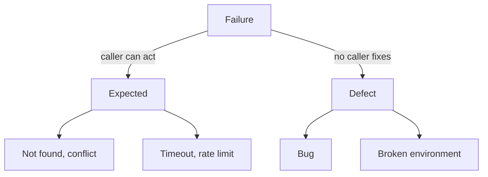
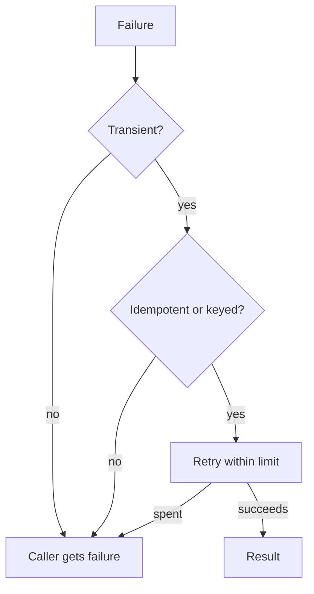

# Errors

> Governs a failure: raised, caught, carried, shown.

## Vocabulary

A failure is **expected** when the contract foresees it and a caller can act on it, such as not found, invalid input or a conflict, and a **defect** when it is a bug or a fault of the machine or the setup it runs on that no caller can fix.

An answer an outside system gives on purpose to turn a request down, such as a declined payment or a client-error status, is an expected failure, whether or not that system's contract lists it.

An **optional part** is one the user can do without, such as analytics, a preview or a recommendation.

A **supervisor** is a unit that runs workers, reports their failures and starts them again.

An **interface** of the program is one way its users reach it, such as a command line, a server's API, a user interface or a consumer of messages.

The **handler of last resort** is the one place where a failure nothing else handled is turned into what the user of an interface sees.

A failure is **handled** where the code changes what the program does next because of it; logging it and carrying on is not handling it.

A **transient** failure is one the same request might not meet again, such as a timeout, a dropped connection or a rate limit, and it is expected.

A retry is **safe** when the operation is idempotent by design or carries an idempotency key its receiver honours.

## Kinds of failure

### failure-is-expected-or-defect · MUST

Every failure is expected or a defect, and is carried as the kind it is.

#### Why

A caller handles only what it foresees, so a defect carried as an expected failure hands it a case it cannot act on, and an expected failure carried as a defect ends work a caller could have saved.

#### Examples



### defect-never-replaced-by-a-fallback · MUST

Every defect reaches its caller as a defect, never replaced by a fallback value. Exempt: the one fallback where an optional part is called, which shows the part as unavailable.

#### Why

A defect handled like an expected failure hides the bug and corrupts the data that follows.

#### Examples

```pseudo title="Avoid"
function invoiceTotal(invoice)
  try
    return sumLines(invoice.lines)
  catch error
    return Money.zero(invoice.currency)
```

```pseudo title="Prefer"
function invoiceTotal(invoice)
  return sumLines(invoice.lines)
```

### expected-failure-carries-a-stable-code · SHOULD

Every expected failure carries a stable code a caller branches on and details that say what to do.

#### Why

A caller with no stable code to branch on reads the failure's shape or its message and breaks when either changes, and one with no details is left to guess what to do.

#### Examples

```pseudo title="Avoid"
# orders/domain/order/errors/order-not-found.error
class OrderNotFoundError extends Error
  message = "Order not found"
```

```pseudo title="Prefer"
# orders/domain/order/errors/order-not-found.error
class OrderNotFoundError extends Error
  code = "order.not-found"
  orderId: OrderId
```

### expected-failure-is-the-programs-own-error · SHOULD

Every expected failure is an error of the program's own, never one of the framework that serves the program.

#### Why

A caller handed a framework's error has no code of the program's to branch on, and its handling breaks when the framework changes its errors.

#### Examples

```pseudo title="Avoid"
# orders/application/use-cases/commands/cancel-order.use-case
if order is <absent> then
  throw new HttpNotFoundException("order not found")
```

```pseudo title="Prefer"
# orders/application/use-cases/commands/cancel-order.use-case
if order is <absent> then
  throw new OrderNotFoundError({ orderId: input.orderId })
```

### expected-failure-named-in-the-signature · SHOULD

Every function names in its signature each expected failure it can produce. It names it in its signature's type, or in one named type of its failures beside it.

#### Why

A failure no signature names reaches a caller who never wrote a case for it.

#### Examples

```pseudo title="Avoid"
function cancelOrder(input, context) -> Order
```

```pseudo title="Prefer"
type CancelOrderError = OrderNotFoundError | OrderAlreadyShippedError

function cancelOrder(input, context) -> Order | CancelOrderError
```

### expected-failure-documented-where-no-signature-names-it · SHOULD

Every expected failure no signature can name is named in the function's documentation. The documentation gives the condition it arises in, whether its package publishes the function or not.

#### Why

A caller handles only the failures it knows of, and where no signature and no compiler carry them, the documentation is the one place a caller inside the package or outside it learns of them.

#### Examples

```pseudo title="Avoid"
function cancelOrder(input, context)
  ...
```

```pseudo title="Prefer"
# Fails with OrderNotFoundError when no order has input.orderId,
# and with OrderNotCancellableError when the order has shipped.
function cancelOrder(input, context)
  ...
```

### failure-told-apart-by-code · MUST

Every failure is told apart by its type or its code, never by its message.

#### Why

A message is text anyone may reword at any time, so code that branches on it breaks silently at the next rewording.

#### Examples

```pseudo title="Avoid"
catch error
  if error.message.includes("not found") then
    return showEmptyCart()

  throw error
```

```pseudo title="Prefer"
catch error
  if error.code is CartNotFoundError.code then
    return showEmptyCart()

  throw error
```

### failure-names-only-reachable-steps · SHOULD

Every failure names only a next step its reader can take. The step it names, such as an operation to call, a program to start or a value to send, exists, is open to the one the failure reaches with the rights they hold, and accepts what it names.

#### Why

Whoever reads a failure (a person, a script, a language model) follows its advice literally, so a step it cannot take leaves them stuck or retrying the same rejection.

#### Examples

```pseudo title="Avoid"
throw new InvoiceLockedError({
  nextStep: "invoices edit "
    + invoice.id + " --force"
})
# no --force flag exists
```

```pseudo title="Prefer"
throw new InvoiceLockedError({
  nextStep: "invoices credit-note "
    + invoice.id
})
```

### parse-failure-lists-every-problem · SHOULD

Every failed parse of a value from outside lists every problem at once. It is one expected failure whose details name every problem found.

#### Why

A parse that stops at the first problem makes its caller fix and resend once for each.

#### Examples

```pseudo title="Avoid"
throw new InvalidOrderError({  # stops at the first problem
  problems: [
    { path: "email",
      problem: "format" }
  ]
})
```

```pseudo title="Prefer"
throw new InvalidOrderError({
  problems: [
    { path: "email",
      problem: "format" },
    { path: "lines[0].quantity",
      problem: "below minimum" }
  ]
})
```

### parse-failure-never-repeats-the-rejected-value · MUST

Every failed parse names each problem by its path, never by the value it rejected.

#### Why

A rejected value repeated in the failure carries what the sender sent into every log the failure reaches.

#### Examples

```pseudo title="Avoid"
throw new InvalidSignupError({
  problems: [
    { path: "email", problem: "'bob@' is not an email" },
    { path: "iban", problem: "'DE89 3704 0044' is too short" },
  ]
})
```

```pseudo title="Prefer"
throw new InvalidSignupError({
  problems: [
    { path: "email", problem: "format" },
    { path: "iban", problem: "too short" },
  ]
})
```

## Catching and carrying

### catch-handles-only-what-it-recognises · MUST

Every failure is handled only where it is recognised by its type or its code. This holds whether it is caught or returned as a value, and every other failure is passed on, raised again or returned. Exempt: where an optional part is called, a supervisor, and the handler of last resort.

#### Why

A failure handled where it is not understood is handled wrongly, and one logged and carried on leaves the program running on a state nobody expected.

#### Examples

```pseudo title="Avoid"
try
  call chargePayment(order)
catch error
  log(error)
# goes on as if it was charged
```

```pseudo title="Prefer"
try
  call chargePayment(order)
catch error
  if error.code is PaymentDeclinedError.code then
    return askForAnotherCard()

  throw error
```

### failure-never-dropped-unread · MUST

Every failure is read where it arrives, never dropped unread: no catch is empty and no returned failure is discarded. Exempt: a failure ignored on purpose, with a suppression that says why.

#### Why

A swallowed failure, caught or returned, turns into wrong data that shows up far from its cause.

#### Examples

```pseudo title="Avoid"
try
  call mailer.send(receiptFor(order), context)
catch error
  # nothing
```

```pseudo title="Prefer"
try
  call mailer.send(receiptFor(order), context)
catch error
  if error.code is MailboxUnavailableError.code then
    return order with { receipt: Unsent }

  throw error
```

### dependency-failure-mapped-where-it-is-wrapped · MUST

All code that wraps a dependency maps each failure of it that it recognises to one of the program's own. Every other passes as a defect, wrapped at most once in a defect of the program's own, never as an expected failure.

#### Why

A dependency's failure that leaves its wrapper unmapped ties every caller to the dependency's errors, so a change of dependency breaks code far from it, and one mapped to an expected failure hands its caller a case it cannot act on.

#### Examples

```pseudo title="Avoid"
# payments/infrastructure/card-gateway/payment.adapter
function charge(payment, context)
  try
    call client.charge(toCharge(payment), context)
  catch error
    throw new PaymentDeclinedError(
      { cause: error })
```

```pseudo title="Prefer"
# payments/infrastructure/card-gateway/payment.adapter
function charge(payment, context)
  try
    call client.charge(toCharge(payment), context)
  catch error
    if error.kind is "declined" then
      throw new PaymentDeclinedError(
        { cause: error })

    if error.kind is "rate-limited" then
      throw new PaymentUnavailableError(
        { cause: error })

    throw error
```

### optional-part-isolated-from-its-faults · MUST

Every failure inside an optional part stops where that part is called. It is contained there, and the operation that called the part goes on.

#### Why

A fault in a part the user can do without otherwise takes down the action it serves.

#### Examples

```pseudo title="Avoid"
# composition/checkout/presentation/bindings/commands/check-out
function onCheckOut(input, { checkOut, analytics }, context)
  call checkOut(input, context)
  call analytics.send("purchase_completed", { order_id: input.orderId })
# an analytics fault fails checkout
```

```pseudo title="Prefer"
# composition/checkout/presentation/bindings/commands/check-out
function onCheckOut(input, { checkOut, analytics }, context)
  call checkOut(input, context)

  try
    call analytics.send("purchase_completed", { order_id: input.orderId })
  catch error
    reportFault(error)
```

### error-keeps-its-cause · MUST

Every error that maps another keeps it as its cause.

#### Why

An error mapped without its cause loses the trace and the message that point at the bug, and whoever reads it starts the search from nothing.

#### Examples

```pseudo title="Avoid"
catch error
  if isCardDeclined(error) then
    throw new PaymentDeclinedError()

  throw error
```

```pseudo title="Prefer"
catch error
  if isCardDeclined(error) then
    throw new PaymentDeclinedError({ cause: error })

  throw error
```

### raised-value-is-an-error · MUST

Where the language raises failures, only an error is raised, never a string, a plain object or another value. Exempt: the value a framework's contract has its callers raise to steer it.

#### Why

A raised value that is no error has no stack and no code, so no handler recognises it and no log traces it.

#### Examples

```pseudo title="Avoid"
if cart.isEmpty then
  throw "cart is empty"
```

```pseudo title="Prefer"
if cart.isEmpty then
  throw new EmptyCartError(cart.id)
```

## Retries

### transient-failure-reaches-its-caller-once-no-retry-is-left · MUST

Every transient failure reaches its caller only once the level that retries it has no retry left or none is safe. That level is the one `failure-retried-at-one-level` gives.

#### Why

A transient failure passed on before its retries are used up stacks the caller's retries on the callee's, and the caller retries what the callee was still retrying.

#### Examples

```pseudo title="Avoid"
# payments/infrastructure/card-gateway/payment.adapter
function charge(payment, context)
  retry up to MAX_CHARGE_ATTEMPTS times, with backoff, on transient failure
    try
      call client.charge(toCharge(payment), context)
    catch error as RateLimitedError
      throw new PaymentUnavailableError({ cause: error })
```

```pseudo title="Prefer"
# payments/infrastructure/card-gateway/payment.adapter
function charge(payment, context)
  retry up to MAX_CHARGE_ATTEMPTS times, with backoff, on transient failure
    call client.charge(toCharge(payment), context)

  on retries spent with error
    throw new PaymentUnavailableError({ cause: error })
```

### failure-retried-only-when-transient · MUST

Every failure is retried only when it is transient and a retry is safe, and only within a limit.

#### Why

A retry of a failure that will not change wastes time, and one of an operation that is not idempotent repeats its effect.

#### Examples



### failure-retried-at-one-level · MUST

Every failure is retried at one level: by the code nearest the call or, where something else runs the work again within its own limit, such as a broker or a scheduler, by that run alone. No level above retries a failure whose retries are used up.

#### Why

Retries stacked at several levels multiply each other's attempts, keeping a struggling system down.

#### Examples

```pseudo title="Avoid"
# orders/application/use-cases/commands/pay-order.use-case
retry up to MAX_PAY_ATTEMPTS times, with backoff, on PaymentUnavailableError
  call payments.charge(order.total, { key: order.paymentKey }, context)

# payments/infrastructure/card-gateway/payment.adapter
retry up to MAX_CHARGE_ATTEMPTS times, with backoff, on transient failure
  call client.charge(toCharge(payment), context)
```

```pseudo title="Prefer"
# orders/application/use-cases/commands/pay-order.use-case
call payments.charge(order.total, { key: order.paymentKey }, context)

# payments/infrastructure/card-gateway/payment.adapter
retry up to MAX_CHARGE_ATTEMPTS times, with backoff, on transient failure
  call client.charge(toCharge(payment), context)
```

### retry-waits-by-backoff-or-the-asked-delay · MUST

Every retry waits by an exponential backoff with a random spread, or for the delay the other side asks for.

#### Why

Retries that fire at once, or all together, turn one failure into a crowd that keeps the other side down — exponential backoff with jitter.

#### Examples

```pseudo title="Avoid"
for each attempt in 1..MAX_RATE_ATTEMPTS
  try
    return fetchRates()
  catch error
    if not isTransient(error) then
      throw error

    wait(RETRY_DELAY)  # every client retries at the same moment
```

```pseudo title="Prefer"
for each attempt in 1..MAX_RATE_ATTEMPTS
  try
    return fetchRates()
  catch error
    if not isTransient(error) then
      throw error

    wait(error.retryAfter
      or jitteredBackoff(attempt))
```

## At the interfaces

### last-resort-handler-one-per-interface · MUST

Each interface of the program has one handler of last resort. It turns every failure that reaches it into what that interface's user sees. Failures may be caught in any number of places of the interface, and each of them hands its defect to that handler.

#### Why

Without one handler per interface, a failure reaches its user in whatever shape the code that met it chose, or in the runtime's own, with internals shown and no next step.

#### Examples

```pseudo title="Handler"
# presentation/bindings/last-resort
function runCommandLine(args, runCommand)
  try
    call runCommand(args)

    return ExitCode.Success
  catch error
    if isExpectedFailure(error) then
      printFailure(error.code, error.details)

      return ExitCode.Failure

    let incidentId = reportDefect(error)

    printFailure("internal", { incidentId })

    return ExitCode.Defect
```

### failure-ends-the-program-only-at-the-last-resort · MUST

Every failure ends the program only at a handler of last resort.

#### Why

Code that ends the program where it meets a failure skips the handler that would show its user what happened, and the cleanup a stop owes its work.

#### Examples

```pseudo title="Avoid"
# cli/commands/export-invoices
let invoices = call invoiceRepository.listForMonth(month, context)

if invoices is empty then
  print("no invoices")
  exitProcess(1)
```

```pseudo title="Prefer"
# cli/commands/export-invoices
let invoices = call invoiceRepository.listForMonth(month, context)

if invoices is empty then
  throw new NoInvoicesError({ month })
```

### failure-shown-as-what-happened-and-what-next · SHOULD

Every failure a user sees says what happened and what to do next, never a stack trace or the program's internals.

#### Why

A user can act on a next step but not on a trace, and internals shown to a user leak how the program works.

#### Examples

```text title="Avoid"
NullReferenceError: cart.lines[2].price
  at priceCart (orders/cart:42)
  at checkOut (orders/check-out:17)
```

```text title="Prefer"
Your cart could not be priced:
a product in it is no longer sold.
Remove it and check out again.
```
