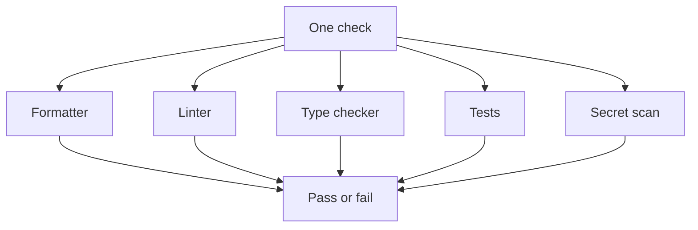

# Tools

> Governs the tools that hold the rules, and their findings.

## Vocabulary

A **tool** is a program the project runs on its code rather than ships, such as a package manager, a linter, a formatter, a test runner or a type checker; an action a language model calls, an agent's or a function the program hands its own model to call, is none.

A tool **holds** a rule when it fails on a violation of it.

A **hook** is a program a tool calls on an event of its work, such as before a change is recorded or before an agent calls a program.

A **suppression** is a mark in the code or a tool's settings that silences findings of a rule the tool keeps in force, such as a lint rule's, a type error, a mutant or a failure ignored on purpose; turning one of the tool's rules off for everything it reads is a setting, never a suppression.

The **indent**{#indent} is two spaces, a default.

The project's **check** is its one run of every tool that holds a rule.

## General

### rule-held-by-a-tool-where-one-can · MUST

Every rule a tool can hold is held by one. Prose carries what no tool can express. Exempt: a rule whose check would cost more to keep than the review it replaces, a choice a decision records.

#### Why

A rule held only by prose is broken as soon as nobody reads it, and a tool never tires.

#### Examples

```text title="Avoid"
docs/contributing.md

Keep each function under
40 lines.
```

```text title="Prefer"
lint settings
  max-function-lines: error, at most 40
```

### one-check-runs-every-tool · MUST

One check runs every tool that holds a rule and fails on any violation.

#### Why

A tool run apart from the one check is skipped by whoever does not know it exists, so a change passes for one person and fails for the next.

#### Examples



## Configuration

### configuration-holds-what-its-blocks-compute · MUST

Every tool's configuration holds what its blocks compute. In the repository's root or a package, it holds every setting the presets of the active blocks give for the rules in force there, on the axes followed there, computed from the blocks.

#### Why

A configuration kept by hand drifts from the blocks: a setting goes missing, loosens or outlives its rule unseen.

#### Examples

```text title="Avoid"
lint.json
  copied from another repository
  and kept by hand
```

```text title="Prefer"
$ constitution presets apply
wrote lint.json, 14 settings
wrote constitution.lock
```

### own-settings-sit-in-the-computed-files · MUST

Every own setting of the root or of a package sits in the same files as the settings its blocks compute.

#### Why

Own settings kept in files of their own make a tool read two configurations that disagree unseen, and each copy of a shared file goes its own way.

#### Examples

```text title="Avoid"
shop/
├── lint.json          computed from the blocks
└── lint.local.json    the project's own rules
```

```text title="Prefer"
shop/
└── lint.json          computed from the blocks,
                       with the project's own rules
```

### own-settings-only-add · MUST

The project's own settings only add to what its blocks compute. They never remove a setting that holds a rule or make it reach less than the rule asks, and they add a further setting, a stricter value, or a value that names the same thing for the project, such as its own path to the same program or its own files a rule's term covers or leaves out. Exempt: an override that lowers a rule, which may remove the setting that holds it or narrow its reach.

#### Why

An own setting that loosens a computed one weakens a rule unseen, where an override would have named the rule and its reason.

#### Examples

```text title="Avoid"
computed  max-function-lines: 100
own       max-function-lines: 200
```

```text title="Prefer"
computed  max-function-lines: 100
own       max-function-lines: 60
own       generated: src/api.gen/
```

### configuration-names-its-schema · SHOULD

Wherever its reader accepts one, every configuration file names the schema its reader publishes.

#### Why

A key misspelt or misplaced in a file with no schema is ignored by its tool in silence, and the setting it was meant to hold never applies.

#### Examples

```text title="Avoid"
lint.json
{
  "linter": { "enabled": true }
}
```

```text title="Prefer"
lint.json
{
  "$schema": "https://lint.example.org/schemas/2.3.0/schema.json",
  "linter": { "enabled": true }
}
```

### linter-rules-turned-on-by-name · MUST

Every linter's rules are turned on by their names, families or codes. A switch that turns on every rule it has is never used.

#### Why

A switch for every rule turns on each rule a new release adds, so an update fails the check with rules nobody chose, some of which contradict others.

#### Examples

```text title="Avoid"
lint.json
{
  "rules": { "all": true }
}
```

```text title="Prefer"
lint.json
{
  "rules": {
    "max-depth": "error",
    "unused-variable": "error",
    "unchecked-type": "error"
  }
}
```

## Formatting

### one-formatter-per-language · MUST

Each language has at most one formatter, and no second formatter touches the language's files. Exempt: a language no active block of the project gives a formatter.

#### Why

Two formatters undo each other's work at every run, and each change then shows lines its author never touched.

#### Examples

```text title="Avoid"
code      formatter A, then the linter's
          formatter: each undoes the other
Markdown  formatter C
```

```text title="Prefer"
code      formatter A
Markdown  formatter C
```

### formatter-covers-every-file-of-its-language · MUST

Every formatter formats every file of its language. Exempt: a language no active block of the project gives a formatter.

#### Why

A file the formatter of its language leaves out is argued over in every review.

#### Examples

```text title="Avoid"
formatter settings
  include: src/**
```

```text title="Prefer"
formatter settings
  include: **
```

### formatters-share-one-indent · MUST

Wherever neither its language nor the formatter fixes the indent, every formatter indents by the indent the vocabulary names.

#### Why

Formatters that disagree on the indent make files of one repository read differently in every editor, terminal and side-by-side diff.

#### Examples

```text title="Avoid"
code      indent 4
Markdown  indent 2
YAML      indent 2
```

```text title="Prefer"
code      indent 2
Markdown  indent 2
YAML      indent 2
```

### formatters-share-one-width · MUST

Wherever it breaks lines at all, every formatter breaks a line longer than 100 columns.

#### Why

Formatters that disagree on the width make one repository read differently in every editor and diff, and at 80 columns a typed signature or a call of a few arguments breaks into several lines that 100 keeps on one.

#### Examples

```text title="Avoid"
code      indent 2, width 80
Markdown  indent 2, width 120
YAML      indent 2, width 80
```

```text title="Prefer"
code      indent 2, width 100
Markdown  indent 2, width 100
YAML      indent 2, width 100
```

## Findings

### suppression-silences-one-finding · MUST

Every suppression silences one finding. It sits on the finding's line or the line above it, or names the finding, and it names the one rule it silences wherever the tool can.

#### Why

A narrow suppression can be judged where it stands, and a broad one silences rules and lines nobody meant to.

#### Examples

```pseudo title="Avoid"
# orders/tax
# lint-disable complexity: one branch per country of the tax table

function vatRate(country, category)
  ...

function exciseRate(product)
  ...
```

```pseudo title="Prefer"
# orders/tax
# lint-ignore-next-line complexity: one branch per country of the tax table
function vatRate(country, category)
  ...

function exciseRate(product)
  ...
```

### suppression-states-its-reason · MUST

Every suppression states its reason.

#### Why

A suppression without its reason leaves the next reader unable to tell whether the exception still holds, so it is kept for ever or removed blind.

#### Examples

```pseudo title="Avoid"
# lint-ignore-next-line complexity
function vatRate(country, category)
```

```pseudo title="Prefer"
# lint-ignore-next-line complexity: one branch per country of the tax table
function vatRate(country, category)
```

### unused-suppression-removed · MUST

Every suppression is removed once it silences nothing.

#### Why

A suppression left after its finding is gone silences the next finding on its line unseen.

#### Examples

```pseudo title="Avoid"
# lint-ignore-next-line complexity: one branch per country of the tax table
function vatRate(country, category)
  return VAT_RATES[country][category]
```

```pseudo title="Prefer"
function vatRate(country, category)
  return VAT_RATES[country][category]
```

### check-never-weakened-to-pass · MUST

Every failing check is made to pass by fixing its cause. It is never made to pass by changing a test's expectation, skipping or deleting a test, adding a suppression, special-casing a test input or loosening a tool's configuration. Exempt: such a change that is the task, that another rule asks for or permits, or that a person consented to by name.

#### Why

A check made green by weakening it reports a success that did not happen.

#### Examples

```pseudo title="Avoid"
test "should add VAT to the total"
  # Arrange
  let cart = createCart({ netPrice: 100 })
  # Act
  let total = grossTotal(cart)

  # Assert (was 120 before it failed)
  assert total is 100
```

```pseudo title="Prefer"
test "should add VAT to the total"
  # Arrange
  let cart = createCart({ netPrice: 100 })
  # Act
  let total = grossTotal(cart)

  # Assert
  assert total is 120
```
