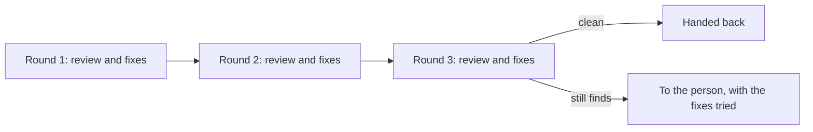

# Agents

> Governs how an agent's work is designed with its person, reviewed and submitted.

## Vocabulary

A **submission** is an agent's work offered for acceptance into the project, to become an accepted change, or for sharing or for shipping.

An **accepted change** is one that whoever the project trusts with that decision has taken into what the project builds and ships from.

A **review round** is one review of a change and the fixes it asks for.

## Design

### design-settled-with-its-person-first · SHOULD

Every question of design is settled with the agent's person before code is written for it. Exempt: a question agent-asks-before-a-consequential-change already takes to the person.

#### Why

Code written on an unsettled design is rewritten when it is settled.

#### Examples

```text title="Avoid"
Person: Let customers save their
        carts.
Agent:  Done: a carts table, a
        sync worker and a cache,
        1,400 lines.
```

```text title="Prefer"
Person: Let customers save their
        carts.
Agent:  Two designs:
        a) a saved-carts table,
           ~300 lines, nothing new
           installed;
        b) a) and a cache, ~900
           lines, adds a cache
           server.
        Which one?
Person: a.
```

### design-question-brought-with-its-cost · SHOULD

Every question of design comes to the agent's person with its cost, the code and specs it adds.

#### Why

A person who decides without the cost chooses a design other than the one that gets built.

#### Examples

```text title="Avoid"
Agent:  Should invoices be sent by
        a queue or right away?
```

```text title="Prefer"
Agent:  Should invoices be sent by
        a queue or right away?
        a) right away: ~80 lines,
           2 specs;
        b) a queue: ~450 lines,
           9 specs, a queue server
           to run.
```

### grown-design-cost-taken-back-to-the-person · SHOULD

Every design whose cost grows past what was settled goes back to the agent's person before more is built.

#### Why

A cost that outgrew the settled one makes the settled design a decision nobody took, and the person learns of it only when the work is done.

#### Examples

```text title="Avoid"
(settled: saved carts, ~300 lines)

Agent:  Done: saved carts, plus a
        sync between devices that
        they needed, 1,100 lines.
```

```text title="Prefer"
(settled: saved carts, ~300 lines)

Agent:  Saved carts need a sync
        between devices to work on
        a phone: ~800 more lines.
        Build it, or keep carts to
        one device?
```

## Review

### agent-review-stops-after-three-rounds · SHOULD

Every review between agents of one change stops after three review rounds.

#### Why

Each round's fixes give the next round something new to find, so a loop between agents grows the change instead of settling it.

#### Examples



### review-left-open-goes-to-the-person · MUST

Everything the third round of a review between agents still finds goes to the agent's person, with the fixes tried.

#### Why

What three rounds left open is a decision for the person, and a finding dropped when the review stops ships as a defect nobody chose.

#### Examples

```text title="Avoid"
Round 3: the reviewer still finds the
refund can run twice on a retry.

Agent:  Three rounds done; handing
        back.
```

```text title="Prefer"
Round 3: the reviewer still finds the
refund can run twice on a retry.

Agent:  Three rounds done. Still
        open: the refund can run
        twice on a retry. Tried: a
        lock (deadlocked the spec),
        then a check before the
        call (still races). Your call.
```

## Submission

### person-decides-what-is-submitted · MUST

Only a person decides what of an agent's work is submitted. An agent submits only when its person asks or a standing grant names the act.

#### Why

Accepting, sharing and shipping a change are decisions made under the person's name, so an agent that takes them alone makes the person answer for what they never chose.

#### Examples

```text title="Avoid"
Agent:  Fixed the bug; committed
        and pushed it.
```

```text title="Prefer"
Agent:  Fixed the bug; the diff is
        ready. Commit and push?
Person: Commit it.
Agent:  Committed; not pushed.
```

### sub-agent-never-submits · MUST

Every sub-agent hands its work back to the agent that delegated to it, never submitting it.

#### Why

The person sees only the agent they talk to, so a submission a sub-agent makes is one no person asked for or saw.

#### Examples

```text title="Avoid"
Sub-agent: Wrote the refund specs,
           committed them and opened
           pull request #57.
```

```text title="Prefer"
Sub-agent: Wrote the refund specs in
           orders/__tests__/; nothing
           committed. Handing back.
```

### submitted-change-read-by-its-person · MUST

Every agent's change is submitted only once a person has read it and can explain it. Exempt: a change an agent submits under a standing grant with no person present, which a person reads and can explain before it is accepted.

#### Why

The person who submits or accepts a change answers for it, and a change nobody read is answered for by nobody.

#### Examples

```text title="Avoid"
Reviewer: Why are drafts not
          refunded when cancelled?
Person:   Not sure; the agent
          wrote it.
```

```text title="Prefer"
Reviewer: Why are drafts not
          refunded when cancelled?
Person:   A draft was never paid,
          so there is nothing to
          refund.
```

### submission-carries-no-agent-attribution · MUST

Every submission made under a person's name answers to that person alone, with no attribution to an agent. No agent or language model that helped write it is named anywhere, such as in a change, its description or a document.

#### Why

An attribution names an agent as answerable where only the person is, and readers then weigh the change by its agent instead of by its review. A co-author line in a change is also read by tools: the service that keeps the changes lists the agent as a contributor, and a contributor-agreement check there blocks a change whose co-author cannot sign.

#### Examples

```text title="Avoid"
fix: Refund a paid order once

The refund ran twice on a retry.

Generated with an AI assistant
Co-Authored-By: An AI <ai@example.com>
```

```text title="Prefer"
fix: Refund a paid order once

The refund ran twice on a retry.
```
