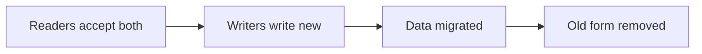

# Formats

> Governs a shared format: its schema, what is written in it, the spec that checks it, and how it changes.

## Vocabulary

A **shared format** is a format that another program or the program's user reads or writes, or that the program stores for its later releases to read, such as an API's contract, a message, a webhook, a file its user writes or a store's schema.

## Schema

### shared-format-declared-in-a-schema · MUST

Where its form has a schema language, every shared format is declared in a schema a machine reads.

#### Why

A format declared in prose is read differently by each reader — a published language.

#### Examples

```text title="Avoid"
features/invoices/infrastructure/files/
├── dtos/
│   └── invoice-file.dto
├── invoice-export.adapter
└── README.md            the file's format, in prose
```

```text title="Prefer"
features/invoices/infrastructure/files/
├── dtos/
│   ├── invoice-file.dto
│   └── invoice-file.schema.json
└── invoice-export.adapter
```

### schema-kept-in-the-repository · MUST

Every schema of a shared format is kept in the repository, or generated from code kept there.

#### Why

A schema kept elsewhere cannot change in the change that changes its format, so the two drift, and the specs check the writer against a schema its readers no longer have.

#### Examples

```text title="Avoid"
orders/
├── contracts/
│   └── README.md        schema: see the platform wiki
└── src/
```

```text title="Prefer"
orders/
├── contracts/
│   └── order-placed.schema.json
└── src/
```

## What is written

### format-written-with-only-its-declared-fields · MUST

Where a shared format has a schema, everything the program writes in it carries only the fields the schema declares. It never writes one of its objects serialised whole. Exempt: what the program writes to a store only its own releases read.

#### Why

An object sent whole sends every field later added to it to every reader.

#### Examples

```pseudo title="Avoid"
function publishOrderPlaced(order, context)
  call broker.publish("order-placed", serialize(order), context)
```

```pseudo title="Prefer"
function publishOrderPlaced(order, context)
  call broker.publish("order-placed", {
    orderId: order.id,
    customerId: order.customerId,
    total: { amount: order.total.amount, currency: order.total.currency },
    placedAt: order.placedAt,
  }, context)
```

### enumeration-in-a-shared-format-declared-extensible · MUST

Every enumeration the program writes into a shared format is declared extensible. Its readers are told to expect values they do not know. Exempt: a set complete by its meaning, such as a sort direction or the days of the week, which stays closed, and an enumeration in a store only the program's own releases read.

#### Why

A reader that fails on a new value breaks on the first one its writer adds, though nothing it relies on changed.

#### Examples

```text title="Avoid"
OrderPlaced:
  status:
    enumeration: [draft, paid, shipped]
```

```text title="Prefer"
OrderPlaced:
  status:
    enumeration: [draft, paid, shipped]
    extensible: true
    description: Readers expect values not listed here.
```

## Proof

### written-format-checked-against-its-schema · MUST

Where a shared format has a schema, everything the program writes in it is checked by a spec against that schema.

#### Why

A writer that drifts from its schema is found by a reader in production instead of by a spec.

#### Examples

```pseudo title="Avoid"
test "should write the order-placed event"
  # Arrange
  let order = createOrder({ id: "ord-7" })
  # Act
  let event = orderPlacedEvent(order)

  # Assert
  assert event.orderId is "ord-7"
```

```pseudo title="Prefer"
test "should write the order-placed event its schema declares"
  # Arrange
  let order = createOrder({ id: "ord-7" })
  # Act
  let event = orderPlacedEvent(order)

  # Assert
  assert orderPlacedSchema.accepts(event)
```

## Changes

### format-changed-in-steps · MUST

Every shared format changes in steps. Each change keeps the old data and the running readers working: the readers learn the new form beside the old one first, the writers and the stored data move to it next, and the old form is removed last. Exempt: a store whose readers all stop while its format changes, such as an embedded database its one program migrates as it opens it.

#### Why

Data written before a change and readers deployed before it outlive the change, and a format switched in one step breaks them — the expand–contract pattern.

#### Examples



### format-change-checked-against-its-last-release · MUST

Every change to a shared format is checked against its last release. The check fails on every change that breaks a reader or a writer of that release, such as a removal, a rename, a narrowed type or a new required part. Exempt: a store whose readers all stop while its format changes, and the removal of an old form its readers and writers have all left or were told would go on a date now past.

#### Why

A breaking change reads like any other in review, so one that no check compares with what was released ships and breaks every reader and writer still on the old form.

#### Examples

```text title="Avoid"
$ check
specs        214 passed
```

```text title="Prefer"
$ check
specs        214 passed
contracts    order-placed.schema.json against release 3.4.0
             breaking: field "total" renamed to "amount"
             failed
```
