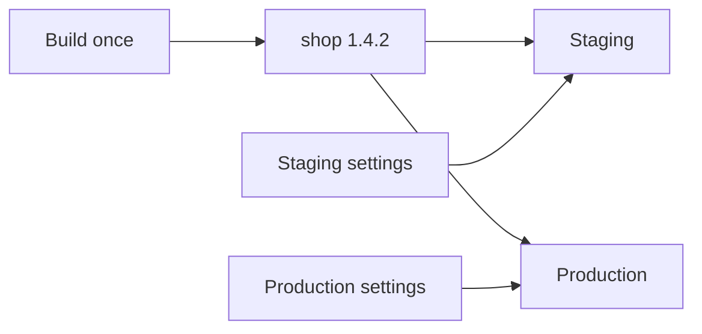

# Artefact

> Governs the artefact a program is built as: the one artefact that serves every deployment environment, and the settings it never holds.

## General

### one-artefact-serves-every-environment · MUST

Every program the project itself runs or serves on a host runs as one artefact in every deployment environment. An artefact is meant as core's tests chapter defines it, and such a program is, for instance, a server, a worker or a scheduled job.

#### Why

An artefact made for each deployment environment is one nobody tested — the twelve-factor app.

#### Examples



### environment-setting-reaches-the-artefact-from-its-host · MUST

Every setting that differs between deployment environments reaches the artefact from its host, never built into it.

#### Why

A setting built into an artefact carries one deployment environment's values, its secrets among them, wherever the artefact goes — the twelve-factor app.

#### Examples

```text title="Avoid"
build shop 1.4.2 for production
  built in   API_URL = https://api.shop.example
             PAYMENTS_KEY = (production key)
```

```text title="Prefer"
build shop 1.4.2
  built in   no setting

deploy shop 1.4.2 to production
  host hands API_URL, PAYMENTS_KEY
```
